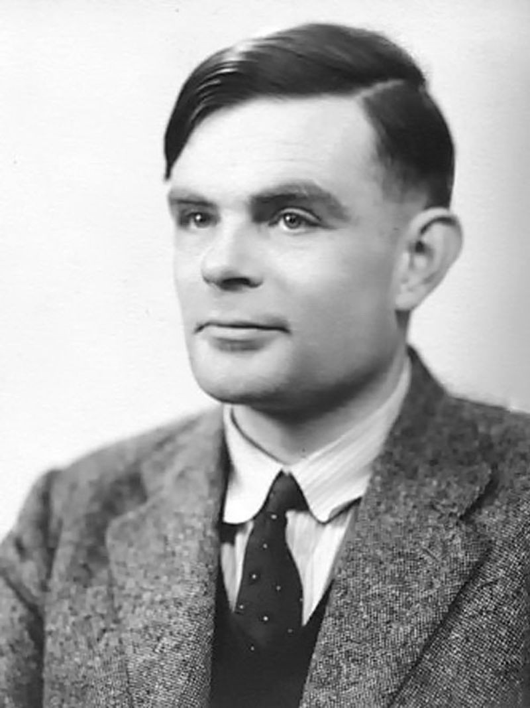
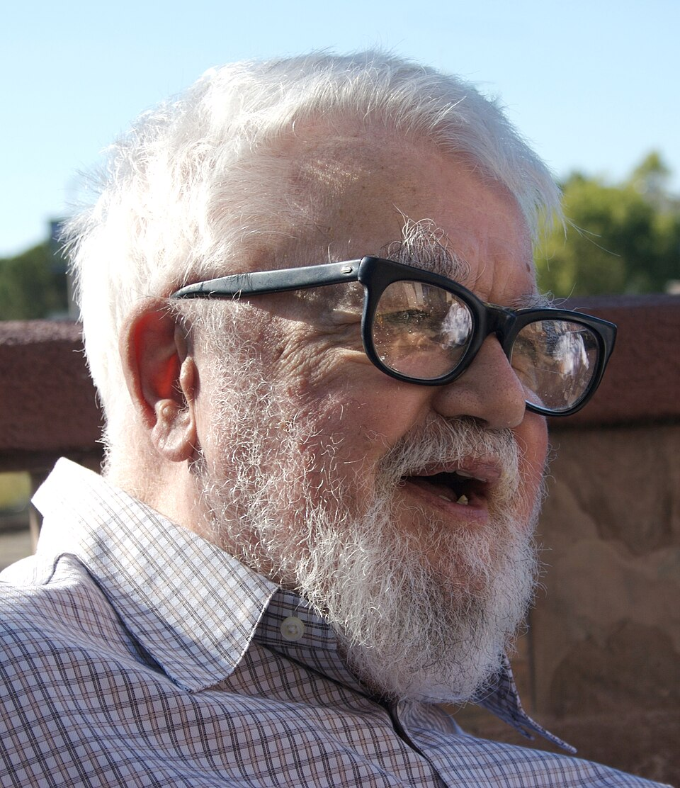

# Automated reasoning within artificial intelligence

The course studies **Automated Reasoning** as a central area of Artificial Intelligence. The opening question is therefore not only what automated reasoning is, but also where it belongs within the broader history and aims of AI.

## Turing's imitation game

In 1950, Alan Turing opened *Computing Machinery and Intelligence* with the question:

> Can machines think?

Rather than answering the philosophical question directly, Turing proposed the **imitation game**. In the original game, an interrogator communicates with two hidden participants and tries to determine their identities from their answers. Turing's operational reformulation replaces one participant with a machine: if the interrogator cannot reliably distinguish the machine from the human participant through the conversation, the machine succeeds in the game.

The important methodological move is that intelligence is evaluated through observable behaviour rather than through an inaccessible internal property called “thinking”.

## The emergence of artificial intelligence

The name **Artificial Intelligence** was introduced by John McCarthy in connection with the 1956 Dartmouth Summer Research Project on Artificial Intelligence. The proposal gathered researchers interested in describing intelligence precisely enough that aspects of it could be simulated by machines. Participants and contributors associated with this early period included Allen Newell and Herbert Simon, whose early program addressed problem solving.

{#fig-alan-turing fig-align="center" width="30%"}

Two formulations presented in the lecture describe different emphases:

- **Strong AI:** “the science and engineering of making intelligent machines”;
- **Weak AI:** the science of making machines perform tasks that would require intelligence if performed by humans.

The first formulation focuses on constructing intelligent machines. The second focuses on reproducing intelligent behaviour, without requiring a claim about whether the machine possesses intelligence in the same sense as a person.

{#fig-john-mccarthy fig-align="center" width="34%"}

## Automated reasoning as a current AI priority

The lecture connects this history to the 2025 AAAI Presidential Panel report. Automated reasoning is identified as a major challenge because AI systems require forms of reasoning whose conclusions can be checked and justified.

::: {.callout-important title="AI is not only machine learning"}
Machine learning is one major part of contemporary AI, but it does not exhaust the field. Knowledge representation, logical inference, constraint solving, planning, search, and automated reasoning address questions that cannot be reduced to statistical prediction alone.
:::

# Thinking fast and thinking slow

The lecture uses Daniel Kahneman's distinction between two modes of reasoning:

{#fig-daniel-kahneman fig-align="center" width="30%"}

- **Thinking fast:** immediate, automatic, and intuitive;
- **Thinking slow:** deliberate, controlled, and potentially computationally expensive.

Examples illustrate the difference:

- avoiding a moving ball is immediate, while deliberately passing the ball requires a chosen action;
- computing $2\cdot2$ is immediate, while computing $3471\cdot265$ requires deliberate calculation;
- choosing a banknote for a routine payment is simple, while deciding whether to buy a house requires extended reasoning.

The distinction motivates two broad AI traditions:

- **sub-symbolic AI**, including neural networks, machine learning, deep learning, and large language models, is associated with fast learned responses;
- **symbolic AI**, including knowledge representation, automated reasoning, rule-based reasoning, and logical reasoning, is associated with explicit, deliberate inference.

This course concentrates on the second perspective. The objective is to understand not only how to derive a result, but also **when and why reasoning requires time**.

```{mermaid}
%%| fig-cap: "The two reasoning modes and their connection to the AI perspectives presented in the lecture."
flowchart LR
    A["Reasoning"] --> F["Thinking fast"]
    A --> S["Thinking slow"]
    F --> SS["Sub-symbolic AI"]
    S --> SY["Symbolic AI"]
    SS --> ML["Learning and immediate prediction"]
    SY --> AR["Explicit inference and search"]

    classDef fast fill:#e8f1ff,stroke:#2f6fb0,stroke-width:2px;
    classDef slow fill:#fff2cc,stroke:#b38600,stroke-width:2px;
    class F,SS,ML fast;
    class S,SY,AR slow;
```

# Symbolic AI and computational limits

Symbolic AI includes areas such as:

- declarative programming;
- computational logic;
- knowledge representation and reasoning;
- constraint programming;
- automated theorem proving;
- problem solving;
- search.

These areas provide languages, algorithms, complexity results, and many open problems.

A crucial point is that some limitations are mathematical rather than merely technological. Complexity theory can prove that certain kinds of optimal solutions require exponentially many computational steps in the worst case, subject to standard complexity assumptions. Faster hardware or a different implementation may improve constants and practical performance, but cannot automatically remove the intrinsic combinatorial difficulty.

Research in symbolic AI therefore studies methods that make reasoning as efficient as possible, including:

- better representations;
- propagation and inference;
- search heuristics;
- symmetry breaking;
- global constraints;
- parallel execution;
- hybrid solving methods.

The label “old AI” is misleading. The lecture lists recent work at major AI and logic conferences to show that symbolic reasoning, planning, logic programming, monitoring, explanation, and program learning remain active research areas.

# Course organisation

The course is mandatory in the MSc Artificial Intelligence & Cybersecurity and optional in the MSc Computer Science curriculum. The expected background includes:

- some programming experience;
- basic logic;
- basic computational complexity;
- familiarity with computability issues, where available;
- curiosity and willingness to model problems precisely.

The course includes practical sessions with small programming assignments. The examination is written and covers all course material, including proofs and written programming; a short oral discussion may follow.

The outline presented in the lecture includes:

1. Constraint Programming;
2. CSP and COP;
3. NP-hardness;
4. solving CSPs through SAT;
5. constraint propagation and search;
6. global constraints;
7. modelling in MiniZinc;
8. Logic Programming;
9. definite programs and default negation;
10. Answer Set Programming;
11. complexity classes for Automated Reasoning;
12. action languages and planning;
13. learning of programs.

# Introduction to Constraint Programming

Constraint Programming is a **declarative programming paradigm** rooted in AI and designed for modelling and solving combinatorial problems.

In an imperative program, the programmer specifies a sequence of operations. In Constraint Programming, the modeller instead describes:

- the unknown quantities;
- the possible values of each quantity;
- the relationships that valid solutions must satisfy.

The solving system is responsible for finding assignments that satisfy the model.

## Why use a declarative model?

Constraint Programming separates two concerns:

- **problem modelling**, which states what constitutes a solution;
- **solution search**, which determines how to find one.

This separation makes models comparatively readable and easy to modify. The modeller may express heterogeneous constraints directly, while solver techniques handle propagation and search. Search is also amenable to parallelisation, and heuristics can be added to guide the exploration.

The annotation summarises the intended workflow as:

> The programmer states the constraints; the system finds a solution.

This does not mean that modelling choices are irrelevant. A clear model, a suitable representation, and effective search heuristics can determine whether a solver handles an instance efficiently.

```{mermaid}
%%| fig-cap: "Separation between declarative modelling and solver-controlled search."
flowchart LR
    P["Problem"] --> M["Variables, domains, constraints"]
    M --> S["Solver"]
    S --> I["Propagation and inference"]
    I --> H["Search and heuristics"]
    H --> R["Solution or proof of infeasibility"]

    classDef model fill:#fff2cc,stroke:#b38600,stroke-width:2px;
    classDef solve fill:#e2f0d9,stroke:#548235,stroke-width:2px;
    class M model;
    class S,I,H solve;
```

## Brief historical development

The lecture highlights several milestones:

- Sketchpad, developed by Ivan Sutherland in 1963;
- the notion of a Constraint Satisfaction Problem, associated with Ugo Montanari in 1972;
- domain filtering, associated with David Waltz in 1975;
- constraint propagation research in the late 1970s and early 1980s;
- Constraint Logic Programming in the late 1980s;
- global constraints and additional languages during the 1990s;
- hybrid methods, standardisation, parallelism, and learning in the new millennium;
- the MiniZinc Challenge from 2010 onward.

The historical message is that modern Constraint Programming combines modelling languages, inference algorithms, search techniques, and optimisation methods developed over several decades.

# Running example: the 4-Queens problem

The 4-Queens problem asks for four queens to be placed on a $4\times4$ chessboard so that no two queens attack each other.

A useful representation introduces one variable for each column:

$$
X_1,X_2,X_3,X_4.
$$

The meaning is:

$$
X_i=j
$$

if and only if the queen in column $i$ is placed in row $j$.

Each variable has domain

$$
D(X_i)=\{1,2,3,4\}.
$$

This representation automatically places exactly one queen in every column. The remaining constraints prevent horizontal and diagonal attacks.

## Horizontal attacks

For every pair of columns $i<j$,

$$
X_i\neq X_j.
$$

If $X_i=X_j$, the two queens occupy the same row and therefore attack horizontally.

## Diagonal attacks

For every pair $i<j$,

$$
|X_j-X_i|\neq j-i.
$$

The horizontal distance between the queens is $j-i$. They share a diagonal exactly when the absolute row difference equals that column difference.

## Wrong and correct assignments

The assignment

$$
X_1=X_2=X_3=X_4=1
$$

is invalid because all queens occupy the same row.

A valid assignment shown in the lecture is

$$
(X_1,X_2,X_3,X_4)=(2,4,1,3).
$$

The row values are all different, and for every pair $i<j$ the row difference is different from the column difference. Hence no two queens attack horizontally or diagonally.

```{r}
#| label: fig-four-queens-comparison
#| fig-cap: "The invalid assignment $(1,1,1,1)$ and the valid assignment $(2,4,1,3)$ under the column-variable representation."
#| fig-width: 9
#| fig-height: 4.5
#| echo: false
#| warning: false
#| message: false

plot_queens <- function(rows, title) {
  plot.new()
  plot.window(xlim = c(0, 4), ylim = c(0, 4), asp = 1)

  for (column in 0:3) {
    for (row in 0:3) {
      colour <- if ((column + row) %% 2 == 0) "#f7f7f7" else "#777777"
      rect(column, row, column + 1, row + 1,
           col = colour, border = "#303030", lwd = 1.2)
    }
  }

  for (column in seq_along(rows)) {
    board_row <- 4 - rows[column]
    points(column - 0.5, board_row + 0.5,
           pch = 21, cex = 3.1, lwd = 2.5,
           bg = "#2f75b5", col = "#17365d")
    text(column - 0.5, board_row + 0.5,
         labels = "Q", col = "white", font = 2, cex = 1.1)
  }

  axis(1, at = 0.5:3.5, labels = paste0("X", 1:4), tick = FALSE, line = -0.5)
  axis(2, at = 0.5:3.5, labels = 4:1, las = 1, tick = FALSE, line = -0.5)
  title(main = title, line = 0.6)
  box()
}

op <- par(mfrow = c(1, 2), mar = c(2.5, 2.5, 2.5, 1))
plot_queens(c(1, 1, 1, 1), "Invalid: all queens share row 1")
plot_queens(c(2, 4, 1, 3), "Valid: no shared row or diagonal")
par(op)
```

# Constraint Satisfaction Problems

A **Constraint Satisfaction Problem** (CSP) consists of:

- a finite set of variables
  
  $$
  V=\{V_1,\ldots,V_n\};
  $$

- one domain $D_i$ for each variable $V_i$;
- a set of constraints
  
  $$
  C=\{C_1,\ldots,C_m\}
  $$

  over those variables.

A candidate assignment chooses one value from each domain:

$$
\omega\in D_1\times\cdots\times D_n.
$$

An **admissible solution** is an assignment that satisfies every constraint in $C$.

The lecture deliberately keeps “constraint” and “satisfaction” intuitive at this stage; their formal definitions are postponed to the next lecture.

# Constraint Optimization Problems

A **Constraint Optimization Problem** (COP) extends a CSP with an objective function

$$
f:D_1\times\cdots\times D_n\to A,
$$

where the codomain $A$ is ordered so that objective values can be compared.

The task is to find an admissible CSP solution that minimises, or equivalently maximises after reformulation, the value of $f$.


| Aspect | CSP | COP |
|---|---|---|
| Main question | Does a feasible assignment exist? | Which feasible assignment is best? |
| Required ingredients | Variables, domains, constraints | Variables, domains, constraints, objective |
| Solver result | One or all admissible assignments | An admissible assignment with optimal objective value |
| Extra burden | Establish feasibility or infeasibility | Establish feasibility and prove optimality |

The distinction is:

- a CSP asks whether a feasible assignment exists, or asks for one or all feasible assignments;
- a COP asks for the best feasible assignment according to an objective.

# Search space

Given

$$
\langle X_1\in D_1,\ldots,X_n\in D_n;C\rangle,
$$

the **search space** is

$$
D_1\times\cdots\times D_n.
$$

Each point in this Cartesian product is a complete assignment consistent with the declared domains. The solver searches for the points that also satisfy all constraints.

The search space is commonly represented as a tree:

- level $1$ selects a value for $X_1$;
- level $2$ selects a value for $X_2$;
- and so on;
- leaves correspond to complete assignments.

In general, domains may also be infinite, although the 4-Queens example has finite domains.

```{mermaid}
%%| fig-cap: "First levels of the 4-Queens search space. Each branch assigns a value to the next variable."
flowchart TD
    R["Start"] --> A1["X1 = 1"]
    R --> A2["X1 = 2"]
    R --> A3["X1 = 3"]
    R --> A4["X1 = 4"]
    A1 --> B11["X2 = 1: reject"]
    A1 --> B12["X2 = 2: reject"]
    A1 --> B13["X2 = 3"]
    A1 --> B14["X2 = 4"]
    A2 --> B21["X2 = 1"]
    A2 --> B22["X2 = 2: reject"]

    classDef rejected fill:#f8d7da,stroke:#b02a37;
    class B11,B12,B22 rejected;
```

# Naive search strategies

## Generate and test

The most direct method enumerates complete assignments and tests each one afterward.

For 4-Queens, every variable has four possible values, so the number of complete assignments is

$$
4^4=256.
$$

The progressive slides show assignments such as

$$
(1,1,1,1),
(1,1,1,2),
(1,1,1,3),
(1,1,1,4),
(1,1,2,1),\ldots
$$

being generated and rejected. The repeated animation frames represent successive visits to the same search tree, not distinct algorithms.

Generate and test corresponds to a guess-and-verify view: generate a potential solution, then verify whether all constraints hold. The weakness is that a violation discovered from the first two variables does not prevent the method from generating values for the remaining variables.

For anything beyond very small instances, complete enumeration is generally unusable.

## Partial assignments, early checks, and backtracking

A better method tests constraints as soon as enough variables have been assigned to evaluate them.

The procedure is:

1. assign a value to the next variable;
2. check every constraint whose involved variables are assigned;
3. if a violation is detected, abandon the current branch immediately;
4. otherwise continue with the next variable;
5. when no value remains, backtrack to the previous choice.

For the illustrated 4-Queens search, early checking and backtracking reduce the exploration to 19 attempts rather than 256 complete assignments.

Assignments beginning with $X_1=3$ or $X_1=4$ are symmetric to already visited cases. This introduces **symmetry breaking**: if two regions of the search space are equivalent under a symmetry of the problem, one representative region may be explored while the equivalent one is excluded.

Even backtracking with partial checks remains insufficient for many medium and large instances. The exercise proposed in the lecture is to implement both naive methods for the $n$-Queens problem and determine the largest practically solvable $n$.

# Non-naive solving approaches

The lecture lists several major approaches for CSP and COP search:

- local search;
- integer linear programming;
- translation to SAT followed by a SAT solver;
- Constraint Programming;
- Answer Set Programming.

These approaches do not remove the intrinsic hardness of general combinatorial problems. They instead exploit structure, propagation, specialised algorithms, relaxations, heuristics, and efficient implementations.

# Intrinsic complexity and graph colouring

The lecture recalls the **3-colouring problem**. Given a graph, does there exist an assignment of one of three colours to each vertex such that adjacent vertices receive different colours?

For vertices represented by variables $X_1,\ldots,X_n$, use domains

$$
D_i=\{\text{red},\text{green},\text{black}\}.
$$

For every graph edge $(i,j)$, impose

$$
X_i\neq X_j.
$$

This is directly a CSP. The problem is NP-hard, illustrating that CSP solving has intrinsic worst-case difficulty. A general-purpose solver cannot avoid hard instances merely by using a clever implementation, though effective modelling and propagation can make many practical instances manageable.

```{mermaid}
%%| fig-cap: "A valid three-colouring of the six-vertex graph used in the lecture."
flowchart LR
    X1((X1)) --- X2((X2))
    X1 --- X3((X3))
    X1 --- X5((X5))
    X2 --- X4((X4))
    X2 --- X5
    X3 --- X4
    X3 --- X5
    X4 --- X5
    X4 --- X6((X6))
    X5 --- X6

    style X1 fill:#e95420,stroke:#333,stroke-width:2px
    style X4 fill:#e95420,stroke:#333,stroke-width:2px
    style X2 fill:#b6f21a,stroke:#333,stroke-width:2px
    style X3 fill:#b6f21a,stroke:#333,stroke-width:2px
    style X6 fill:#b6f21a,stroke:#333,stroke-width:2px
    style X5 fill:#191970,stroke:#333,stroke-width:2px,color:#fff
```

# Relationship between CSP and COP

The final slides compare feasibility and optimisation through reductions using black-box solvers.

## Solving a CSP with a COP solver

Assume a COP solver is available. Given a CSP

$$
P=\langle X_1\in D_1,\ldots,X_n\in D_n;C\rangle,
$$

define a constant objective, for example

$$
f(X_1,\ldots,X_n)=0.
$$

Every feasible assignment has the same objective value. Therefore, any solution returned by the COP solver is also a solution of the original CSP.

## Solving a discrete COP with a CSP solver

Now assume a CSP solver can answer threshold questions of the form

$$
P_k=
\langle
X_1\in D_1,\ldots,X_n\in D_n;
C,
 f(X_1,\ldots,X_n)\leq k
\rangle.
$$

If the objective takes natural-number values and an upper bound $M$ is known, binary search over $k$ can locate the optimum using at most logarithmically many threshold calls.

The lecture's example assumes the unknown minimum is $15$ and begins with $M=205$. Thresholds such as

$$
205,102,51,25,12
$$

are tested. The first negative answer at $12$ confines the optimum to the interval $[13,25]$. Further midpoint tests narrow the interval until the value $15$ is identified.

For real-valued objectives, the same idea applies only up to a chosen numerical precision.

```{mermaid}
%%| fig-cap: "Relationship between feasibility and optimisation used in the final slides."
flowchart LR
    CSP["CSP"] -->|"constant objective"| COPsolver["COP solver"]
    COP["Discrete COP"] -->|"add f(x) <= k"| CSPsolver["CSP solver"]
    CSPsolver -->|"binary search on k"| OPT["Optimal objective value"]
```

## Feasibility versus proving optimality

CSP and COP are closely related in principle, but may behave differently in practice:

- a large CSP may be solved quickly if a feasible assignment is found early;
- proving that a COP solution is globally optimal may require exploring a large part of the search space;
- in some applications, a sufficiently good solution is acceptable even when global optimality is not proved.
