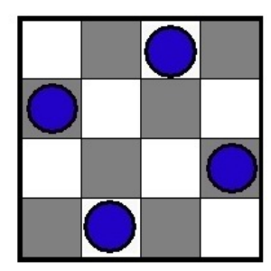

```{=html}
<style>
.formal-box {
  border: 1px solid #c9d1d9;
  border-left: 0.45rem solid #6c757d;
  border-radius: 0.45rem;
  padding: 0.9rem 1.1rem 0.8rem;
  margin: 1.15rem 0;
  background: rgba(127, 127, 127, 0.055);
}
.formal-box > :first-child { margin-top: 0; }
.formal-box > :last-child { margin-bottom: 0; }
.formal-title { font-weight: 700; margin-bottom: 0.5rem; }
.definition-box { border-left-color: #287a62; }
.definition-box .formal-title { color: #287a62; }
.formula-box { border-left-color: #55718e; }
.formula-box .formal-title { color: #55718e; }
.formula-scroll {
  max-width: 100%; overflow-x: auto; overflow-y: hidden; padding: 0.75rem 1rem;
  margin: 1rem 0; border: 1px solid #d0d7de; border-radius: 0.5rem;
  background: rgba(127, 127, 127, 0.06); -webkit-overflow-scrolling: touch;
}
.formula-scroll .MathJax_Display { min-width: max-content; margin: 0; }
body.quarto-dark .formal-box, body.quarto-dark .formula-scroll {
  background: rgba(255, 255, 255, 0.045); border-color: #59636e;
}
body.quarto-dark .definition-box { border-left-color: #69b99d; }
body.quarto-dark .definition-box .formal-title { color: #82cdb1; }
body.quarto-dark .formula-box { border-left-color: #8eafd1; }
body.quarto-dark .formula-box .formal-title { color: #a8c7e5; }
</style>
```


# From ASP syntax to modelling

The previous lecture introduced the syntax of Answer Set Programming (ASP), stable-model semantics, the language's expressive power, and how to execute programs. This lecture turns to practical ASP programming. It first introduces compact syntactic constructs that make encodings easier to write, then uses ASP to model constraint-satisfaction problems and several combinatorial tasks. The final slides return to cardinality constraints to clarify how they behave when they occur in rule heads.


# Ranges and finite sets

When an encoding needs a sequence of consecutive integer values, ASP allows a range to be written directly. For example, the four coordinates of a square can be enumerated either extensionally, with one fact for each value, or intensionally:

```prolog
size(1..4).
```

A range can also depend on a parameter, allowing a program to be reused for different sizes:

```prolog
size(1..n).
```

The constant `n` can be supplied when invoking `clingo`, rather than being fixed in the source. For instance, setting `n=4` makes the range contain the integers 1 through 4:

```bash
clingo -c n=4 nomefile.lp
```

Ranges are particularly useful for declaring finite domains and generating the ground instances of rules over those domains.

For a set of values that is not an interval, such as the prime numbers below 10, the semicolon notation provides a compact alternative to writing each fact separately:

```prolog
prime(2;3;5;7).
```

This is syntactic sugar for the four facts `prime(2).`, `prime(3).`, `prime(5).`, and `prime(7).`.

# Cardinality constraints

Cardinality constraints express how many literals from a collection must hold. They are especially useful when the modelling task involves selecting a prescribed number of alternatives. A ground cardinality constraint can be written as

::: {.formal-box .definition-box}
<div class="formal-title">Cardinality constraint</div>

\[
 n\{L_1;\ldots;L_h;\;\mathop{\mathrm{not}} H_1;\ldots;\mathop{\mathrm{not}} H_k\}m,
\]

where each \(L_i\) and \(H_j\) is an atom, and either bound may be omitted.
:::


For a candidate set of atoms \(S\), the positive literals contribute when their atoms belong to \(S\). Default-negated literals contribute when the corresponding atoms are absent. Thus, if the constraint contains \(k\) default-negated literals, its value is

::: {.formula-box .formal-box}
<div class="formal-title">Value of a cardinality constraint in a set S</div>
\[
\operatorname{val}(C,S)=|S\cap\{L_1,\ldots,L_h\}| + k - |S\cap\{H_1,\ldots,H_k\}|.
\]
:::

The constraint is satisfied exactly when its value lies between the lower and upper bounds:

\[
n\leq \operatorname{val}(C,S)\leq m.
\]

The same notation can be used in non-ground rules. To understand a non-ground cardinality constraint, one can consider its ground instances, which are produced during grounding.

## Exactly one value for each coordinate

A common modelling pattern is to assign exactly one value to each element of a finite domain. In the example, a two-dimensional coordinate ranges over \(1..2\), and each coordinate receives a value from \(1..3\):

```prolog
coord(1..2).
value(1..3).

1 { assign(X,Y,V) : value(V) } 1 :- coord(X), coord(Y).
```

For every pair \((X,Y)\), the cardinality bounds are both 1. The rule therefore selects exactly one atom `assign(X,Y,V)` among the possible values of `V`. In this encoding, `assign` behaves as a function from coordinates to values.

The conditional element `assign(X,Y,V) : value(V)` can be expanded into an explicit list of alternatives for the three values. Grounding then instantiates the rule for each coordinate pair. The slide shows the resulting four ground constraints, one for each point in the 2-by-2 coordinate grid.

## Rewriting a cardinality constraint

The lecture also rewrites the constraint

```prolog
1 { p; q; r } 1.
```

as a collection of nondeterministic choices and denials. Each atom is paired with an auxiliary atom representing its default-negated alternative:


```prolog
p :- not np.
np :- not p.
q :- not nq.
nq :- not q.
r :- not nr.
nr :- not r.
```

The encoding then adds constraints to prevent two of `p`, `q`, and `r` from being true simultaneously, and another constraint to prevent all three auxiliary atoms from being true simultaneously (which would mean that all three original atoms were false):

```prolog
:- p, q.
:- p, r.
:- q, r.
:- np, nq, nr.
```

Together, these conditions require exactly one of `p`, `q`, and `r` to hold. The paired rules provide a nondeterministic choice for each atom; the denials restrict the choices to one selected atom.

# Nondeterministic choice

A cardinality constraint with lower bound 0 and upper bound 1 expresses an optional choice:

```prolog
0 { good(X,Y) } 1 :- coord(X), coord(Y).
```

For every coordinate pair, `good(X,Y)` may be true or false. The rule does not require the atom to be selected, but it allows it to be selected. The same construct can be written more compactly as:

```prolog
{ good(X,Y) } :- lato(X), lato(Y).
```

The lecture notes that this is the same nondeterministic-choice idea seen previously: one may also express the choice using a predicate for the complementary condition, such as `nogood`, and default negation.

# Arithmetic built-ins

ASP provides arithmetic and bitwise built-ins. These operations are evaluated during the grounding process, so they can be used in expressions that determine ground values and conditions.

| Operation | Expression | Operation | Expression |
|---|---:|---|---:|
| Addition (`plus`) | `L + R` | Subtraction (`minus`) | `L - R` |
| Unary minus (`uminus`) | `-R` | Multiplication (`times`) | `L * R` |
| Division (`divide`) | `L / R` | Modulo (`modulo`) | `L \ R` |
| Absolute value (`absolute`) | `\|R\|` | Power (`power`) | `L ** R` |
| Bitwise AND (`bitand`) | `L & R` | Bitwise OR (`bitor`) | `L \| R` |
| Bitwise XOR (`bitxor`) | `L ^ R` | Bitwise NOT (`bitneg`) | `~R` |


The lecturer also mentions that custom functions can be supplied through external code (for example, C or C++), with details depending on the current tool documentation.

# Aggregates

Aggregates define numerical functions over sets of values. The lecture focuses on `#sum` and `#count`, and emphasizes that aggregate semantics collect sets, not multisets. This matters when different ground instances satisfy the same condition and produce duplicate aggregate elements.

## The `#sum` aggregate and set semantics

Consider the following facts and aggregate:

```prolog
dom(1..3).
p(1,1). p(2,2). p(3,3).
somma(S) :- S = #sum { Y : dom(X), p(X,Y) }.
```

The values collected by the aggregate are 1, 2, and 3, so the sum is 6. If the third fact is changed to `p(3,2)`, the aggregate collects the values 1 and 2. The value 2 occurs twice among the satisfying ground instances, but the aggregate set contains it only once, so the sum is 3 rather than 5 or 4:

```prolog
dom(1..3).
p(1,1). p(2,2). p(3,2).
somma(S) :- S = #sum { Y : dom(X), p(X,Y) }.
```

The lecture asks what changes if the aggregate tuple includes `X` as well:

```prolog
dom(1..3).
p(1,1). p(2,2). p(3,2).
somma(S) :- S = #sum { Y,X : dom(X), p(X,Y) }.
```

Now the collected tuples are distinct because the second component distinguishes the two instances with value 2. Their first components are summed, producing 5. Adding a tuple component can therefore change which elements are distinct for aggregate collection, even if the aggregate's numeric contribution is still the first tuple component.

## The `#count` aggregate

`#count` counts the distinct aggregate elements satisfying the conditions. In the example, only the fact whose second argument is greater than 2 satisfies the filter:

```prolog
dom(1..3).
p(1,1). p(2,2). p(3,3).
conta(S) :- S = #count { p(X,Y) : dom(X), p(X,Y), Y > 2 }.
```

The count is 1. As with `#sum`, the aggregate is set-based, so duplicate elements do not automatically count multiple times.

# Modelling constraint-satisfaction problems with ASP

The lecture now applies the syntactic constructs to combinatorial problems. In these encodings, a candidate solution is represented by atoms, cardinality constraints generate choices, and denial constraints eliminate assignments that violate the problem's requirements.

## The N-Queens problem

The 4-Queens task is to place four queens on a 4-by-4 chessboard so that no two queens attack one another. The lecture defines `queen(I,J)` to mean that a queen is placed at cell \((I,J)\), and uses `numero(1..n)` as the board-coordinate domain. The example board shown in the slides is one valid 4-Queens arrangement:

{fig-alt="Four queens on a four-by-four chessboard, at row-column positions (1,3), (2,1), (3,4), and (4,2)."}

```prolog
numero(1..n).

1 { queen(I,J) : numero(I) } 1 :- numero(J).
```

For each column `J`, the rule selects exactly one row `I`. This already enforces the column requirement, so the remaining constraints rule out horizontal and diagonal attacks.

### Horizontal attacks

Two queens must not occupy the same row. The denial is:

```prolog
:- numero(I), numero(J1), numero(J2),
   J1 != J2,
   queen(I,J1), queen(I,J2).
```

It says that an assignment containing two queens in row `I`, in distinct columns `J1` and `J2`, is forbidden. The variables are universally instantiated by grounding; whenever the body is true, the denial rejects the candidate.

### Diagonal attacks

Queens on the same diagonal have equal absolute differences between their row and column coordinates. The lecture expresses the prohibition as:

```prolog
:- numero(I1), numero(I2), numero(J1), numero(J2),
   J1 != J2,
   queen(I1,J1), queen(I2,J2),
   | I1-I2 | = | J1-J2 |.
```

The final arithmetic condition detects a diagonal: the horizontal and vertical distances are equal. The lecture asks what changes if the condition `J1 != J2` is replaced by `I1 < I2`. Since the diagonal-attack relation is symmetric, ordering the row indices avoids considering both orders of the same pair of queens. With the diagonal equation in place, attacking queens necessarily have different rows, so this ordering can be used to represent each pair once.

## Graph coloring

The graph-coloring example uses four vertices and five edges. It consists of a four-cycle with an additional diagonal between vertices 2 and 4.

```{mermaid}
%%| fig-cap: "The graph used in the lecture's coloring example."
graph LR
  v1 --- v2
  v2 --- v3
  v3 --- v4
  v4 --- v1
  v2 --- v4
```

The graph is represented by facts for nodes and edges:

```prolog
node(1..4).

edge(1,2).
edge(2,3).
edge(3,4).
edge(4,1).
edge(2,4).
```

The colors are represented by a finite predicate `col`. The encoding requires exactly one color for each vertex, then forbids adjacent vertices from receiving the same color:

```prolog
col(1..n).

1 { color(X,C) : col(C) } 1 :- node(X).

:- edge(X,Y), col(C), color(X,C), color(Y,C).
```

The first rule defines a function-like assignment of colors to nodes. The denial rejects a color `C` whenever it is assigned to both endpoints of an edge. The lecture also suggests listing named colors, such as yellow, red, and green, instead of using integer colors.

### Symmetry breaking

Color names are interchangeable: permuting the names of the colors can produce a different answer set representing the same partition of the vertices. The lecture fixes vertex 1 to color 1 and makes the edge relation symmetric:

```prolog
color(1,1).
edge(X,Y) :- edge(Y,X).
```

It then introduces an additional denial that orders the colors of selected neighboring vertices of vertex 1:

```prolog
:- col(C1), col(C2),
   edge(1,X), edge(1,Y), edge(X,Y), X < Y,
   color(X,C1), color(Y,C2), C1 < C2.
```

This eliminates some color-permutation variants by imposing a canonical ordering on a local configuration. Symmetry-breaking constraints are not part of the graph's coloring requirements; they restrict the search to representative solutions while aiming to preserve the existence of a solution.

## Schur numbers

The Schur-number encoding partitions the integers from 1 through `n` into `p` parts so that no part contains three integers `X`, `Y`, and `X+Y`. Each integer must belong to exactly one part:

```prolog
number(1..n).
part(1..p).

1 { inpart(X,P) : part(P) } 1 :- number(X).
```

The denial expresses the defining condition of the partition:

```prolog
:- number(X), number(Y), part(P),
   inpart(X,P), inpart(Y,P), inpart((X+Y),P).
```

If `X`, `Y`, and their sum are all assigned to the same part, the constraint is violated. The slide marks `X <= Y` as an optional condition to try. It can avoid symmetric repetitions of the pair `(X,Y)` and `(Y,X)` because the arithmetic sum is unchanged.

The command shown in the lecture asks `clingo` to search with `n=13` and `p=3`:

```bash
clingo -c n=13 -c p=3 schur.lp
```

### Symmetry breaking for the partition

The lecture fixes the first two integers into the first two parts:

```prolog
inpart(1,1).
inpart(2,2).
```

It then defines when a part is already occupied for a given number `X` by checking whether it contains a smaller integer:

```prolog
occupied(X,P) :- number(X), number(Y), part(P),
                  Y < X, inpart(Y,P).
```

A denial prevents `X` from being placed in a part `P` when a smaller-indexed part `P1` is not yet occupied by a smaller integer:

```prolog
:- number(X), part(P), part(P1),
   inpart(X,P), P1 < P, not occupied(X,P1).
```

Together, these rules guide the partition labels into a canonical order. A new part is introduced only when earlier parts have already been occupied, avoiding equivalent solutions obtained by permuting the part names.

## Hamiltonian path

The lecture reuses the `node/1` and `edge/2` predicates and introduces `hc(X,Y)`, meaning that `Y` is the successor of `X` in the path. The encoding requires exactly one outgoing selected edge for each node and exactly one incoming selected edge for each node:

```prolog
1 { hc(X,Y) : edge(X,Y) } 1 :- node(X).
1 { hc(X,Y) : edge(X,Y) } 1 :- node(Y).
```

Reachability starts from node 1 and propagates along the selected successor relation:

```prolog
reachable(X) :- node(X), hc(1,X).
reachable(Y) :- node(X), node(Y),
                reachable(X), hc(X,Y).
```

The final denial rejects any node that is not reachable:

```prolog
:- not reachable(X), node(X).
```

The intended combination of one-in/one-out requirements and reachability from node 1 ensures that the selected edges form a single connected traversal rather than separate cycles. However, the slide code does not explicitly include `reachable(1).` as a base case: the first reachability rule derives successors of node 1, not node 1 itself. As written, the final denial also requires node 1 to be reachable, so the code appears inconsistent and would reject a path unless the selected relation somehow reaches node 1 through a cycle. A conventional repair would add `reachable(1).`, but this is not silently inserted into the lecturer’s code. The lecture labels `node/1` and `edge/2` as predicates defined previously.

## Telethon runner-slot assignment

The Telethon example assigns runners to four slots. Each runner may have a slot marked `can`, a slot marked `ok`, or both. The input facts distinguish preferred (`ok`) slots from merely acceptable (`can`) ones:

```prolog
can(andy,1). ok(andy,2). can(andy,3).
can(bob,1). can(bob,2). ok(bob,4).
ok(charlie,2). can(charlie,4).
can(dexter,1). can(dexter,4).
```

The `runner/1` predicate collects anyone appearing in either relation, and `available/2` combines the two slot relations:

```prolog
runner(X) :- can(X,_).
runner(X) :- ok(X,_).

available(X,T) :- can(X,T).
available(X,T) :- ok(X,T).
```

The assignment is a bijection between runners and slots: each runner is assigned exactly one slot, and each slot receives exactly one runner. The lecture's source uses the predicate name `corrialle/2` for this assignment relation:

```prolog
1 { corrialle(X,T) : slot(T) } 1 :- runner(X).
1 { corrialle(X,T) : runner(X) } 1 :- slot(T).
```

A denial checks that the selected slot is available for the assigned runner:

```prolog
:- runner(X), slot(T), corrialle(X,T), not available(X,T).
```

The model therefore admits assignments using either `can` or `ok` slots. The next slide improves the solution by minimising the number of assigned slots that are not marked `ok`:


```prolog
annoyance(F) :- F = #count { X :
          runner(X), slot(T),
          corrialle(X,T), not ok(X,T) }.
#minimize { F : annoyance(F) }.
```

The aggregate counts the runners assigned to slots without an `ok` fact. The minimize statement prefers answer sets with a smaller such count, so an assignment that uses more preferred slots is selected when possible. This objective does not change the basic bijection or availability requirements; it ranks feasible assignments.

# Exercise: a quantified formula over extensional facts

The final exercise assumes that `p/5` is defined by ground facts, for example:

```prolog
p(ascanio,rossi,m,1972,udine).
p(bartolomeo,verdi,m,1983,gorizia).
p(berenice,neri,f,1995,pordenone).
```

The question asks for an ASP program that defines an auxiliary predicate `phi` with the same truth value as the quantified formula

\[
\Phi = \exists X\,\forall Y\,\exists Z\,\forall W\,\exists Q\;p(X,Y,Z,W,Q).
\]

The program must include the extensional facts for `p/5`. The lecturer suggests introducing auxiliary predicates, likely one for each quantifier alternation, to express the formula's truth. The computational reflection asks how this kind of formula relates to material studied with Professor Carla Piazza, and whether the approach is coherent with ASP's NP-completeness; the exercise is left open for the student.

# Extra notes on cardinality constraints in rule heads

The last slides provide a schematic translation of cardinality constraints used in rule heads, including default-negated literals. They note that including default-negated literals among the head literals has no effect on the stable model: such literals cannot contribute to supporting an atom.

For the form

\[
\ell\{a_1,\ldots,a_m,\;\mathop{\mathrm{not}} d_1,\ldots,\mathop{\mathrm{not}} d_n\}u \leftarrow BODY,
\]

the slides introduce fresh atoms `b` and `c` and outline the following translation:

```prolog
b :- BODY.
{ a1, ..., am } :- b.
c :- l { a1, ..., am, not d1, ..., not dn } u.
:- b, not c.
```

The first rule activates `b` when the original body holds. The choice rule provides support for the positive head atoms. The third rule checks whether the original cardinality condition is satisfied, and the denial requires that check to succeed whenever `b` is active. The lecture stresses that the positive atoms can be supported by the choice rule, while default-negated literals obtain their truth from the absence of the corresponding atoms and are checked in the cardinality condition.

## Special case: `0 { not d } 1`

The slide considers the cardinality constraint `0 { not d } 1` and explains its translation as:

```prolog
b :- true.
{} :- b.
c :- 0 { not d } 1.
:- b, not c.
```

The empty choice rule is useless. Since `d` does not occur as a rule head in this small program, it cannot be made true in a stable model. Consequently, `not d` is true, the cardinality condition is satisfied, `c` is derived, and the final denial is satisfied. The resulting stable-model situation has `d` false.

If the goal is instead to require that between one and two of `p`, `q`, `not r`, and `not s` are true, the slide suggests using classical negation for the negative alternatives:

```prolog
1 { p, q, -r, -s } 2.
```

Here `-r` and `-s` are classically negated atoms, distinct from default negation `not r` and `not s`. The lecturer also notes that an equivalent reformulation using `r` and `s` with different cardinality bounds is possible.
