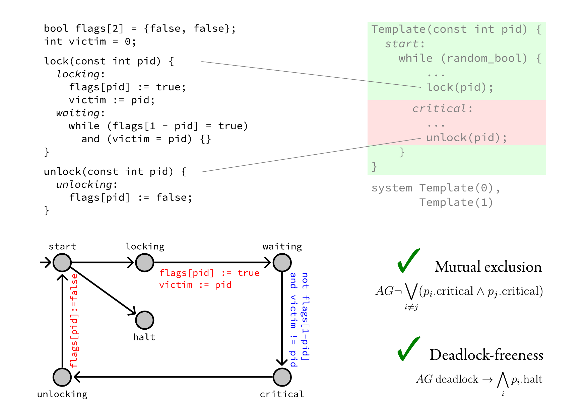
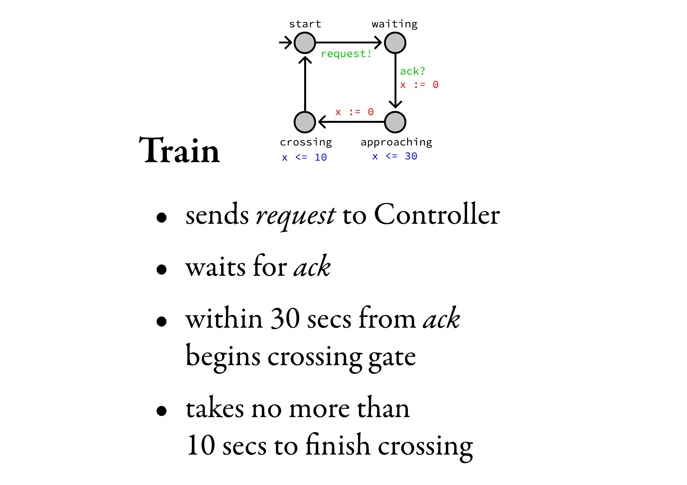
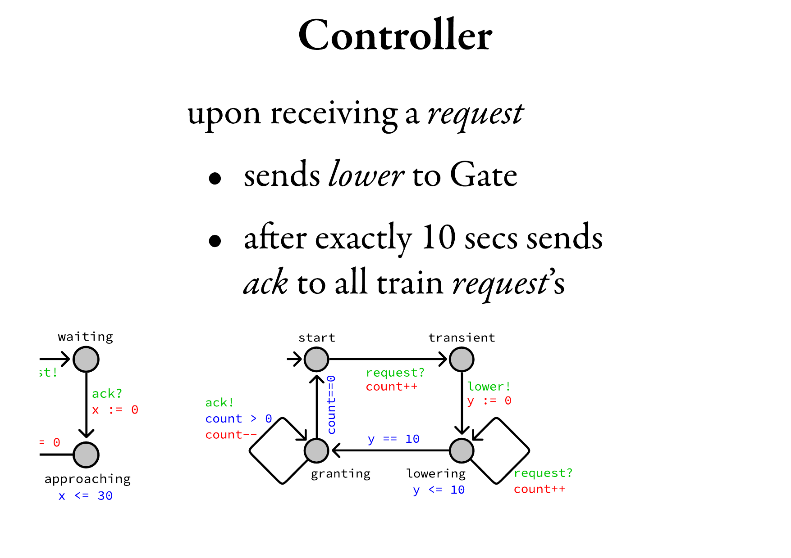
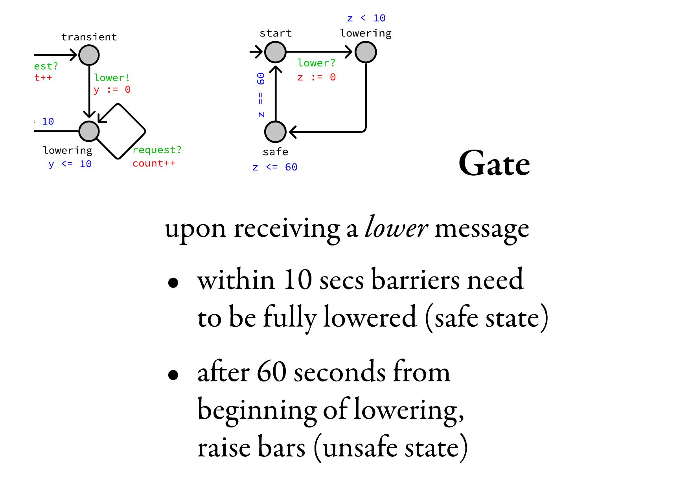
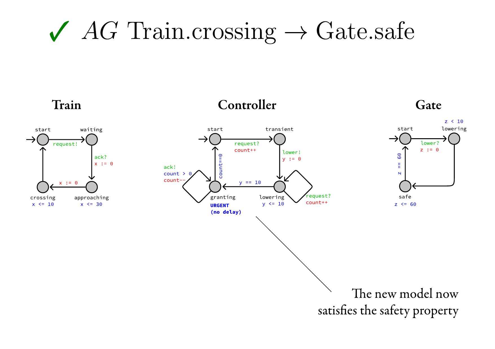
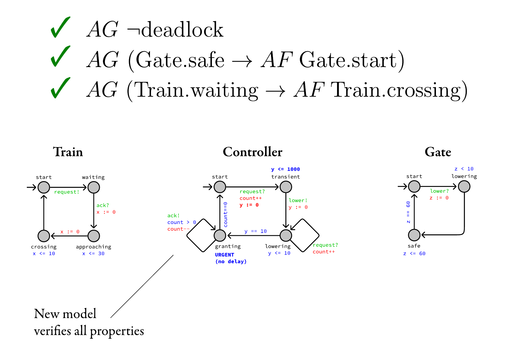

<style>
.formula-scroll {
  max-width: 100%; overflow-x: auto; overflow-y: hidden;
  padding: 0.75rem 1rem; margin: 1rem 0;
  border: 1px solid #d0d7de; border-radius: 0.5rem;
  background: rgba(127,127,127,0.06); -webkit-overflow-scrolling: touch;
}
.formula-scroll .MathJax_Display { min-width: max-content; margin: 0; }
</style>

# UPPAAL models and properties

UPPAAL combines two ingredients introduced in the deck:

1. **networks, or products, of automata**, used to model concurrent timed systems;
2. a **monitorable fragment of CTL**, used to state properties that the model checker verifies.

The models are timed because real-valued clocks measure elapsed time. They are concurrent because several templates execute as one network and can communicate through shared state or synchronous channels.

## Networks of automata

A network is built from automata whose ordinary locations and edges are enhanced with:

- bounded-range variables, such as `int[0,100] i`;
- real-valued clocks, such as `clock x`;
- shared memory, such as `bool flag`;
- synchronous send and receive actions, such as `ack!` and `ack?`.

A channel send and its matching receive occur together. In the introductory example, one component emits `inc!`, another receives `inc?`, and the receiver updates `count++`. The same pattern applies to `dec!` and `dec?`.

## Global states

A global state records:

- one current location for every automaton;
- values of local and global variables;
- values of all clocks;
- satisfaction of the relevant invariants.

The state is therefore not just a location name. Two executions can occupy the same tuple of locations but represent different global states because variables or clock values differ.

## Discrete and delay transitions

The transition relation contains both discrete changes and the passage of time.

| Transition aspect | Meaning |
|---|---|
| Location change | an automaton follows an edge to another location |
| Update | local/global variables change or clocks are reset |
| Delay | time elapses uniformly on all clocks |
| Synchronisation | two automata jointly take matching `!` and `?` edges |
| Guard | an edge may be taken only when its condition holds |

The distinction between a **location invariant** and a **transition guard** is essential. An invariant such as $y\le 1$ limits how long the system may remain at the location. When $y=1$, time may not advance further there. A guard such as $y\ge 1$ only specifies when an outgoing edge becomes enabled; by itself, it does not force the edge to occur, so the system may continue delaying if the current location allows it.

::: {.callout-important}
An enabled edge need not be taken immediately. Preventing delay requires an invariant, an urgent location, or another urgency mechanism. This distinction explains both modelling defects found in the train example.
:::

# The UPPAAL query fragment

The deck presents five query patterns. The path quantifier is written first: $A$ means “for all paths” and $E$ means “there exists a path.” The second symbol describes the temporal requirement.

| UPPAAL form | CTL-style reading | Meaning |
|---|---|---|
| `A[] p` | $AG\,p$ | $p$ holds in every reachable state on every path |
| `E<> p` | $EF\,p$ | some path eventually reaches a state satisfying $p$ |
| `A<> p` | $AF\,p$ | every path eventually reaches a state satisfying $p$ |
| `E[] p` | $EG\,p$ | some path keeps $p$ true forever |
| `A[] (p --> A<> q)` | $AG(p\rightarrow AF\,q)$ | whenever $p$ holds, $q$ must eventually hold on every continuation |

Safety properties commonly use `A[]`; reachability uses `E<>`; inevitability uses `A<>`; and response properties combine `A[]` with `A<>`.

# Mutual exclusion

## The process template and required properties

The first case study instantiates a process template twice, with identifiers $0$ and $1$. Each process repeatedly performs non-critical work, calls `lock(pid)`, enters a `critical` location, and then invokes `unlock(pid)`.

**Mutual exclusion** requires that at most one distinct process is critical at any moment:

::: {.formula-scroll}
$$
AG\,\neg\bigvee_{i\ne j}
\bigl(p_i.\mathit{critical}\land p_j.\mathit{critical}\bigr).
$$
:::

**Deadlock-freeness** requires an enabled non-delay transition, possibly after some delay, unless all processes have legitimately halted. The deck writes this in the form

::: {.formula-scroll}
$$
AG\left(\neg\mathit{deadlock}\lor\bigwedge_i p_i.\mathit{halt}\right).
$$
:::

The halt exception separates an intended terminated state from an unintended global deadlock.

## Algorithm 1: flags only

Each process sets its own flag before waiting:

```text
flags[pid] := true;
while (flags[1-pid] == true) {}
```

On exit, it clears the flag. The model satisfies mutual exclusion because a process enters the critical location only when the other flag is false. It is not deadlock-free: both processes can set their flags to true, after which each waits for the other to clear its flag. Neither process can proceed to the critical location and neither can reach its clearing operation.

## Algorithm 2: victim only

The second proposal uses one shared variable:

```text
victim := pid;
while (victim == pid) {}
```

The model still verifies mutual exclusion, but it is not deadlock-free. A lone process can write its own identifier to `victim` and then wait forever because no competing process updates the variable. The algorithm blocks even without contention.

## Algorithm 3: flags and victim

The third proposal combines the two ideas:

```text
flags[pid] := true;
victim := pid;
while (flags[1-pid] == true && victim == pid) {}
```

A process waits only if the other process is interested and the current process is the designated victim. If both processes compete, the last assignment to `victim` breaks the symmetry: one waits and the other enters. On leaving, a process clears its flag. UPPAAL verifies both requirements for this model.

{fig-alt="UPPAAL slide showing Algorithm 3, its automaton, and green verification results for mutual exclusion and deadlock-freeness."}

The three algorithms can be compared directly:

| Algorithm | Shared information | Mutual exclusion | Deadlock-freeness | Failure mechanism |
|---|---|---:|---:|---|
| 1 | two flags | yes | no | both flags become true and both processes wait |
| 2 | victim | yes | no | a single process waits for another write |
| 3 | flags and victim | yes | yes | victim breaks simultaneous interest |

# Train, controller, and gate

## Informal timing requirements

The second case study consists of three communicating timed automata.

- **Train:** sends `request!`, waits for `ack?`, starts crossing within $30$ seconds of the acknowledgement, and completes crossing within $10$ seconds.
- **Controller:** receives train requests, sends `lower!` to the gate, and sends acknowledgements exactly $10$ seconds after lowering starts. A counter records pending requests.
- **Gate:** receives `lower?`, reaches the `safe` state within $10$ seconds, and returns to `start` after $60$ seconds from the beginning of lowering.

The automata communicate through the channels `request`, `lower`, and `ack`.

## Train automaton

The train moves through `start`, `waiting`, `approaching`, and `crossing`.

{fig-alt="Train automaton with request and acknowledgement synchronisation, clock x reset on acknowledgement, approaching invariant x less than or equal to 30, and crossing invariant x less than or equal to 10."}

From `start`, the train emits `request!` and enters `waiting`. The `ack?` edge resets clock $x$ and enters `approaching`. The invariant $x\le 30$ bounds the time before crossing begins. Entering `crossing` resets $x$ again, and $x\le 10$ bounds the crossing duration.

## Controller automaton

The controller uses locations `start`, `transient`, `lowering`, and `granting`, a pending-request counter, and clock $y$.

{fig-alt="Controller automaton receiving requests, incrementing count, sending lower, timing ten seconds in lowering, and acknowledging pending trains from granting."}

Receiving `request?` increments `count`. The controller emits `lower!`, resets $y$, and remains in `lowering` under invariant $y\le 10$. The edge to `granting` is enabled at $y=10$. From `granting`, `ack!` is sent while `count>0`, and `count` is decremented. When `count==0`, the controller returns to `start`.

## Gate automaton

The gate moves from `start` to `lowering` on `lower?`, resetting clock $z$. It must leave `lowering` before $10$ seconds and enters `safe`. The invariant $z\le 60$ bounds its stay in `safe`, and the edge at $z=60$ returns to `start`.

{fig-alt="Gate automaton with lower synchronisation, clock z, a lowering bound of ten seconds, safe location invariant z less than or equal to 60, and return at z equal to 60."}

# Safety verification and the urgency defect

The safety requirement is

$$
AG\bigl(\mathit{Train.crossing}\rightarrow\mathit{Gate.safe}\bigr).
$$

It says that every reachable state in which the train is crossing must also place the gate in its safe location.

UPPAAL finds that the initial model violates this property. The problem is the controller's `granting` location. Although the acknowledgement edge is enabled, the model allows time to pass there. A delayed acknowledgement shifts the train's $30$-second approaching interval later, while the gate still raises after its fixed $60$-second safe interval. The train can therefore begin or continue crossing after the gate has left `safe`.

The correction marks `Controller.granting` as **urgent**, which forbids delay in that location. Pending acknowledgements are then issued immediately, restoring the intended timing relation. The corrected model satisfies the safety property.

{fig-alt="Corrected train-controller-gate model with Controller granting marked urgent and a green verification result for the crossing implies gate safe property."}

# Liveness verification and the transient-location defect

The deck then checks three properties:

$$
AG\,\neg\mathit{deadlock},
$$

$$
AG\bigl(\mathit{Gate.safe}\rightarrow AF\,\mathit{Gate.start}\bigr),
$$

and

::: {.formula-scroll}
$$
AG\bigl(\mathit{Train.waiting}\rightarrow AF\,\mathit{Train.crossing}\bigr).
$$
:::

The first excludes deadlocks. The second requires the gate eventually to return to `start` whenever it is safe. The third requires every waiting train eventually to cross.

UPPAAL verifies the first two but rejects the train-response property. In the model, the controller may remain forever in `transient` without issuing `lower!`. This infinite-delay behaviour is not a deadlock: delay remains possible. It nevertheless prevents the train from receiving its acknowledgement and reaching `crossing`.

The final model adds clock control to the transient stage. Clock $y$ is reset when entering `transient`, and an invariant $y\le 1000$ gives a finite upper bound on the delay. The exact bound is large, but finiteness is what matters for the stated eventuality: the controller can postpone `lower!`, but cannot postpone it forever. With the urgent `granting` correction retained, UPPAAL verifies all three properties.

{fig-alt="Final train-controller-gate model with transient invariant y less than or equal to 1000 and green checks for deadlock-freeness, gate return, and eventual train crossing."}

::: {.callout-note}
The two counterexamples expose different errors. Unbounded delay in `granting` breaks safety because acknowledgement can occur too late. Unbounded delay in `transient` breaks liveness because lowering may never be issued. The first is repaired with urgency; the second with a finite time bound.
:::
