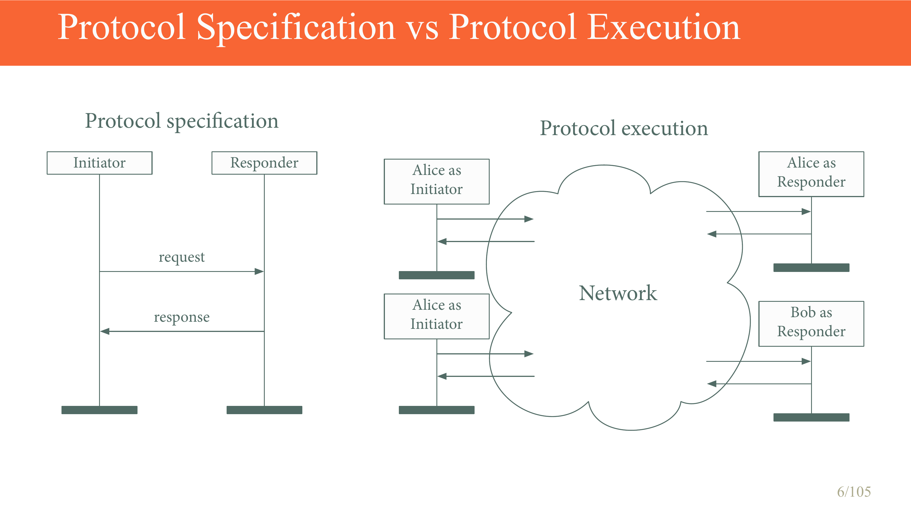
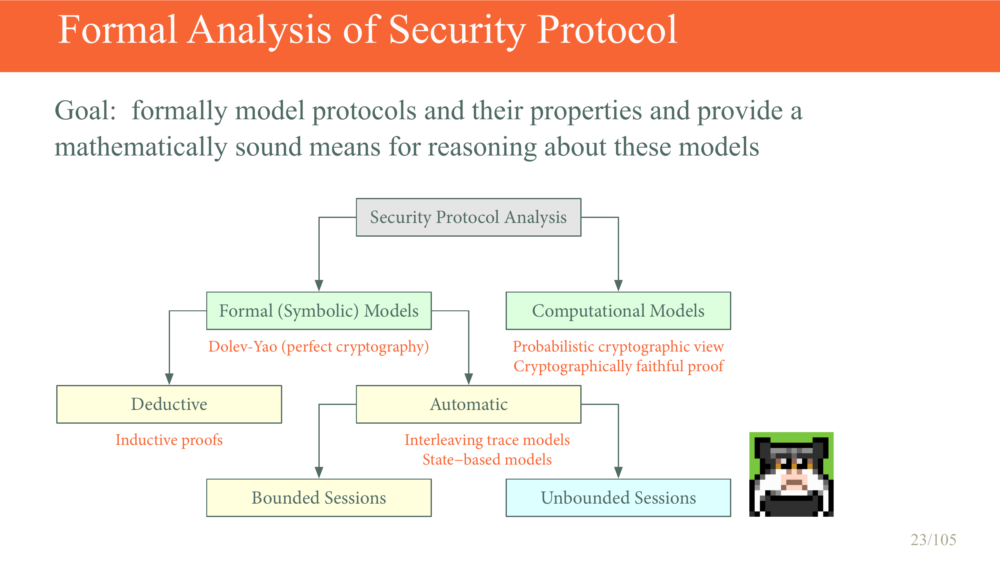
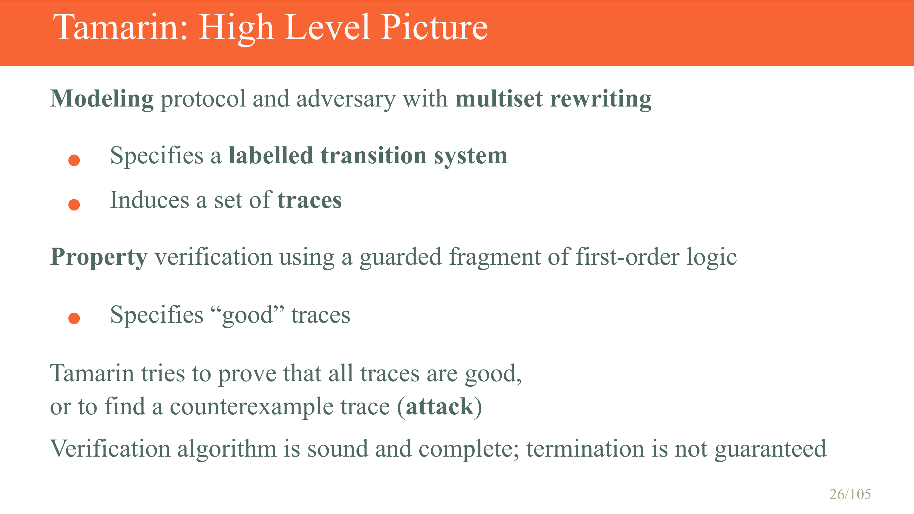
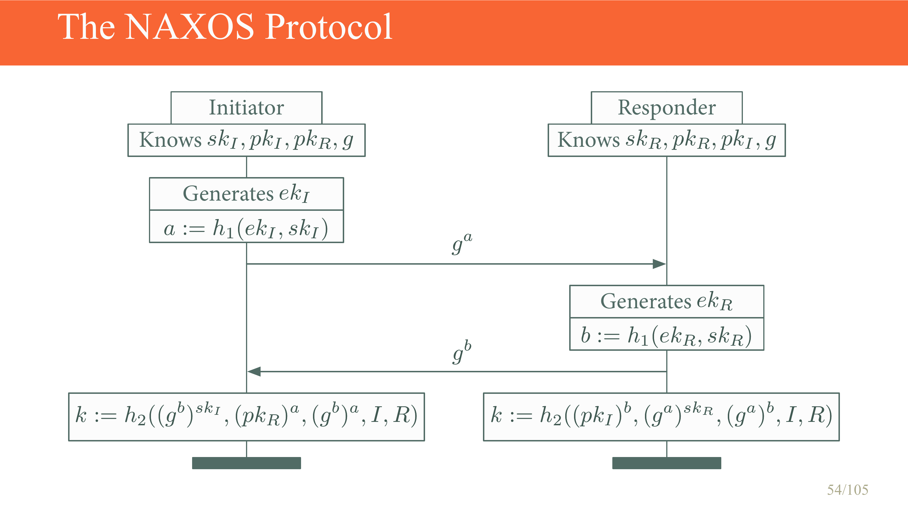
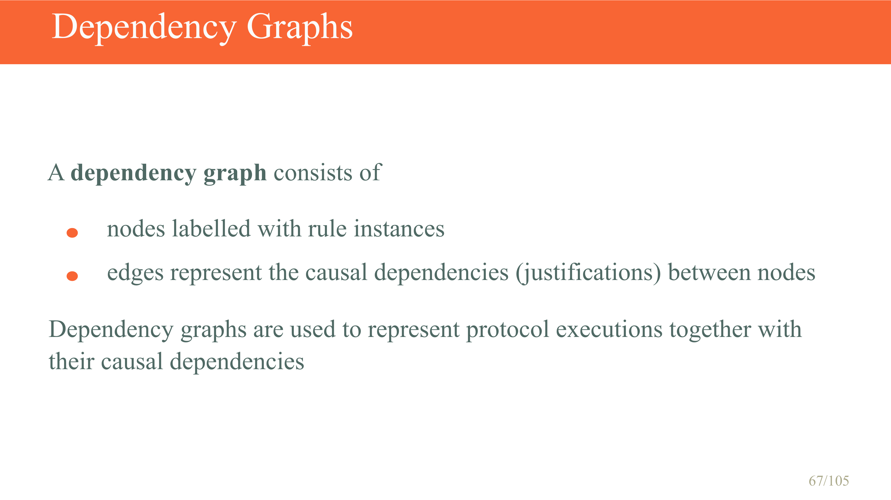
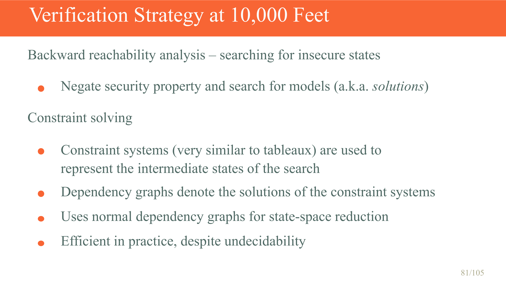

<style>
.formula-scroll {
  max-width: 100%; overflow-x: auto; overflow-y: hidden;
  padding: 0.75rem 1rem; margin: 1rem 0;
  border: 1px solid #d0d7de; border-radius: 0.5rem;
  background: rgba(127,127,127,0.06); -webkit-overflow-scrolling: touch;
}
.formula-scroll .MathJax_Display { min-width: max-content; margin: 0; }
</style>

# Why security protocols require formal analysis

Strong cryptographic primitives such as RSA, DSA, ElGamal, AES, and SHA-3 do not by themselves guarantee a secure distributed application. E-commerce, e-banking, electronic voting, mobile communication, and digital contract signing combine primitives into communication protocols. Errors can arise from the order of messages, omitted identities, replayed values, or incorrect assumptions about what a received message proves.

A **protocol** is a set of rules governing the exchange of messages between two or more principals. It is a distributed algorithm with particular emphasis on communication. A cryptographic protocol employs cryptographic mechanisms to achieve goals such as secrecy, authentication, integrity, key establishment, freshness, or non-repudiation under an explicit threat model.

In a concrete execution, abstract roles are instantiated by agents. One agent may even occupy different roles in different concurrent sessions. The protocol specification therefore describes permitted role behaviour, whereas an execution combines instantiated roles, network activity, and adversarial interference.

{fig-alt="Lecturer slide contrasting an initiator-responder protocol specification with a concrete network execution containing several role instances."}

The central questions are semantic. What does it mean for a key to be known only to two agents? How can an agent know that a key is fresh? What evidence authenticates the peer? Formal verification requires a precise model of messages, agents, adversarial knowledge, executions, and goals.

# Designing a key-establishment protocol

## First attempt: the key in clear text

Assume an honest server $S$ assists initiator $A$ and responder $B$:

```text
A -> S : A, B
S -> A : k_AB
A -> B : k_AB, A
```

The construction fails immediately because $k_{AB}$ is transmitted in clear text. The first threat assumption is that an adversary can eavesdrop on every network message.

## Second attempt: long-term symmetric keys

Assume that $S$ shares a long-term key $k_S(A)$ with each agent $A$:

::: {.formula-scroll}
$$
\begin{aligned}
A&\rightarrow S: A,B,\\
S&\rightarrow A: \{k_{AB}\}_{k_S(A)},\{k_{AB}\}_{k_S(B)},\\
A&\rightarrow B: \{k_{AB}\}_{k_S(B)},A.
\end{aligned}
$$
:::

The encrypted messages resist passive eavesdropping under the **perfect cryptography assumption**: ciphertext can be deciphered only by an agent possessing the required key. The threat model is then strengthened. The adversary may capture, modify, drop, replay, and inject messages.

## The Dolev-Yao adversary and a binding attack

In the **Dolev-Yao model**, the adversary completely controls the network. The adversary can intercept any message and send any term constructible from currently available information, under any apparent sender identity. Cryptographic operations remain ideal: the adversary cannot break encryption but may apply legitimate constructors and destructors when the required material is known.

The adversary may also be a legitimate participant. If intruder $I$ changes $A$'s request from $(A,B)$ to $(A,I)$, the server creates $k_{AI}$. Because the reply to $A$ does not cryptographically bind the intended peer identity to the key, $A$ can mistake this key for one shared with $B$. This is a **binding attack**: a message valid in one context is accepted in another.

The repair is to include peer identities inside the protected data:

::: {.formula-scroll}
$$
\begin{aligned}
A&\rightarrow S: A,B,\\
S&\rightarrow A:
\{k_{AB},B\}_{k_S(A)},\{k_{AB},A\}_{k_S(B)},\\
A&\rightarrow B:\{k_{AB},A\}_{k_S(B)}.
\end{aligned}
$$
:::

## Replay and key compromise

The third attempt identifies peers correctly, but old encrypted tickets can be replayed. If an old session key $k_{AB}$ is later compromised, an adversary can replay the old server response. The agents may accept a known, stale key, allowing the adversary to decrypt, modify, or inject traffic protected under it.

Even without learning the old key, forcing acceptance of an old key is harmful because previous ciphertexts can be replayed. Freshness therefore cannot be inferred solely from successful decryption.

A **nonce** is a random value intended for one use. A challenge-response exchange returns a nonce, or a function of it, to demonstrate that a response belongs to the current run.

## Needham-Schroeder with conventional keys

The fourth attempt is the Needham-Schroeder protocol with conventional keys:

::: {.formula-scroll}
$$
\begin{aligned}
A&\rightarrow S: A,B,N_A,\\
S&\rightarrow A:
\{k_{AB},B,N_A,\{k_{AB},A\}_{k_S(B)}\}_{k_S(A)},\\
A&\rightarrow B:\{k_{AB},A\}_{k_S(B)},\\
B&\rightarrow A:\{N_B\}_{k_{AB}},\\
A&\rightarrow B:\{N_B-1\}_{k_{AB}}.
\end{aligned}
$$
:::

$N_A$ ties the server response to $A$'s current request. The final exchange provides key confirmation: each response demonstrates possession of $k_{AB}$. Nevertheless, the Denning-Sacco attack replays an old ticket for $B$ after the corresponding session key has been compromised. The challenge-response then succeeds because the adversary knows that old key.

## Final design and remaining interpretation issue

The final design begins with a fresh responder nonce:

::: {.formula-scroll}
$$
\begin{aligned}
B&\rightarrow A:A,B,N_B,\\
A&\rightarrow S:A,B,N_A,N_B,\\
S&\rightarrow A:
\{k_{AB},B,N_A\}_{k_S(A)},
\{k_{AB},A,N_B\}_{k_S(B)},\\
A&\rightarrow B:\{k_{AB},A,N_B\}_{k_S(B)}.
\end{aligned}
$$
:::

Each recipient checks a nonce it generated, so the server-protected key is linked to the current run. The protocol avoids the attacks shown under perfect cryptography and server honesty. However, the slides stress that “correct” must still be defined. Unlike the previous protocol, the final design does not give either side explicit key confirmation that the peer actually possesses $k_{AB}$.

| Attack | Root problem | Defence used in the sequence |
|---|---|---|
| Eavesdropping | session key sent in clear | encrypt under long-term keys |
| Binding | peer identity not cryptographically tied to key | include names in encrypted payloads |
| Replay | old protected values remain syntactically valid | use fresh nonces and challenge-response |
| Masquerading after compromise | old key enables a valid response | bind freshness to the current session |

Other attack forms listed in the deck include intruder-in-the-middle, reflection, oracle, and type-flaw attacks. The engineering guidance is correspondingly explicit: every message should say what it means; names essential to interpretation should be present; conditions for acting on a message should be clear; the purpose of encryption and all assumptions should be stated; and timestamp-based designs must account for clock variation.

# Symbolic protocol analysis

Formal analysis models both protocols and properties and provides mathematically sound reasoning over the resulting models. The deck positions symbolic Dolev-Yao analysis against computational, probabilistic cryptographic models and distinguishes deductive from automatic methods and bounded-session from unbounded-session analysis.

{fig-alt="Lecturer slide classifying security protocol analysis into symbolic and computational approaches, and symbolic methods into deductive and automatic analyses with bounded or unbounded sessions."}

Protocol analysis is difficult because the state space is infinite in several independent dimensions:

- the adversary can construct messages of arbitrary size;
- there may be unboundedly many parallel sessions;
- unbounded sessions generate unboundedly many nonces.

The secrecy problem is undecidable in general. The decidability chart in the deck shows that at least two of message size, session count, and nonce count must be bounded in the considered variants. Tamarin targets useful unbounded models despite this undecidability, so termination cannot be guaranteed.

# Tamarin's high-level model

Tamarin combines two formalisms:

1. a protocol and adversary model expressed by **multiset rewriting**, inducing a labelled transition system and a set of traces;
2. security properties expressed in a guarded fragment of first-order logic over traces.

Tamarin tries either to prove that every trace is good or to construct a counterexample trace, interpreted as an attack. Its procedure is sound and complete for the model described in the slides, but it may not terminate.

{fig-alt="Lecturer slide showing multiset rewriting for protocol and adversary modelling, the induced labelled transition system and traces, and guarded first-order logic for good traces."}

```{mermaid}
%%| fig-cap: "Relationship between protocol rules, traces, and security verification in Tamarin."
flowchart LR
  R["Protocol and attacker rules"] --> L["Labelled transition system"]
  L --> T["Execution traces"]
  P["Guarded trace property φ"] --> V["Verification"]
  T --> V
  V -->|"all traces satisfy φ"| O["verification successful"]
  V -->|"some trace satisfies ¬φ"| A["attack trace"]
```

# Terms, equations, and unification

## Sorted term algebra

Messages are represented as well-sorted terms over a signature. The signature shown in the deck includes encryption and decryption, hashing, multiplication and inverses in an exponent group, exponentiation, the unit element, pairing, and projections:

::: {.formula-scroll}
$$
\Sigma_{DH}=
\{\operatorname{enc},\operatorname{dec},h,*,{}^{-1},{}^{\_},1,
\langle\_,\_\rangle,\operatorname{fst},\operatorname{snd}\}.
$$
:::

The sorts include messages, fresh names, and public names. Fresh and public names are constants; variables are available for each sort. Terms are generated inductively: variables are terms, and applying an $n$-ary function symbol to $n$ terms produces another term. **Ground terms** contain no variables.

A substitution maps variables to terms and extends homomorphically. If $\sigma(x)=i(y)$ and $\sigma(y)=e$, then applying $\sigma$ replaces every occurrence consistently throughout a term.

## Equational theories

An equation $t\simeq u$ identifies two terms. Important examples are

$$
\operatorname{dec}(\operatorname{enc}(m,k),k)\simeq m
$$

and the Diffie-Hellman equality

$$
(g^x)^y\simeq(g^y)^x.
$$

A set $E$ of equations induces a congruence $=_E$ and a quotient term algebra. Equality modulo $E$ means that terms belong to the same equivalence class.

The Diffie-Hellman theory in the deck also contains pairing projections, associativity and commutativity of multiplication, neutral and inverse laws, and exponent laws. For example,

::: {.formula-scroll}
$$
((g^a)^b)^{a^{-1}}
=_E g^{(a*b)*a^{-1}}
=_E g^b.
$$
:::

**Unification** asks whether substitutions can make two terms equal modulo the equational theory. Syntactic unification, with no equations, is decidable and has a most general unifier. Unification modulo unrestricted theories is undecidable, motivating restrictions on supported theories.

A rewrite system is terminating when every reduction sequence reaches a normal form, and confluent when diverging reductions can be joined. A convergent system is both. It is **subterm-convergent** when each right-hand side is a proper subterm of the left-hand side, or a ground normal form. This provides a controlled extension mechanism for primitives such as asymmetric encryption and signatures.

# Facts, states, and multiset rewriting

## Linear and persistent facts

A Tamarin state is a finite multiset of facts. Linear facts model resources that can be consumed once. Persistent facts, written with `!` in Tamarin notation, remain available and can be used arbitrarily often.

| Special fact | Kind | Meaning |
|---|---|---|
| $K(m)$ | persistent | message $m$ is known to the adversary |
| $Out(m)$ | linear | the protocol placed $m$ on the network |
| $In(m)$ | linear | the adversary supplied $m$ to the protocol |
| $Fr(n)$ | linear | fresh value $n$ was generated uniquely |

User-defined facts represent protocol-local state.

## Labelled rules and transitions

A rule has the form

$$
L\xrightarrow{A}R,
$$

where $L$, $R$, and $A$ are multisets of facts. For a ground instance $l\xrightarrow{a}r$ applicable in state $S$, linear premises are removed, conclusions are added, persistent premises remain, and action facts $a$ are appended to the trace:

$$
S'=S-\operatorname{lin}(l)+r.
$$

For example,

$$
F(x)\xrightarrow{A(x)}G(h(x))
$$

applied with $x=a$ consumes $F(a)$, produces $G(h(a))$, and appends $A(a)$ to the trace.

Built-in rules generate unique fresh names and model adversary deduction. Representative rules are

$$
Out(x)\longrightarrow K(x)
$$

and

$$
K(x)\xrightarrow{K(x)}In(x).
$$

The adversary can learn public names, create fresh values under its control, and apply public function symbols to known messages. Protocol rules cannot mention $K$ directly; `Out` appears only in conclusions, while `In` and `Fr` appear only in premises. Non-public variables in conclusions must already occur in premises.

## Traces

A trace is the sequence

$$
\langle a_1,\ldots,a_n\rangle
$$

of action multisets produced during execution. Empty action sets can be removed to obtain the observable trace. The examples show why persistent facts matter: a persistent fact such as $!C(a)$ can justify multiple later applications, whereas a linear fact $D(y)$ is consumed and replaced by $D(h(y))$.

# Public-key infrastructure, Diffie-Hellman, and NAXOS

A public-key infrastructure can be modelled by a rule that consumes a fresh secret, records persistent secret and public key facts, and releases the public key:

::: {.formula-scroll}
$$
Fr(y)\longrightarrow !Sk(X,y),!Pk(X,pk(y)),Out(pk(y)).
$$
:::

For Diffie-Hellman keys, $pk(y)$ is represented by $g^y$.

In the basic Diffie-Hellman exchange, $A$ sends $g^a$, $B$ sends $g^b$, and both derive $g^{ab}$. An active adversary can replace both public contributions, establishing separate keys with the two honest agents. The example motivates authenticated key-exchange protocols.

{fig-alt="Lecturer slide showing the NAXOS initiator and responder, their long-term and ephemeral secrets, exchanged Diffie-Hellman values, and derived session-key expressions."}

NAXOS combines each ephemeral secret with the corresponding long-term secret:

$$
a=h_1(ek_I,sk_I),
\qquad
b=h_1(ek_R,sk_R).
$$

The initiator and responder compute matching session keys through combinations of long-term public keys, received exponentials, and the shared Diffie-Hellman component, with identities included in $h_2$.

The formalisation is split into rules:

1. generate a long-term secret/public pair;
2. initiator step 1 creates $ek$, stores `Start`, and outputs $g^a$;
3. responder receives $y=g^a$, creates its ephemeral value, derives $k$, records session actions, and outputs $g^b$;
4. initiator receives $z=g^b$, derives $k$, and records acceptance and matching information.

Action facts such as `Accept`, `Sess`, and `Match` do not represent stored protocol resources. They mark semantically relevant events in traces so that properties can refer to them.

Additional attacker capabilities are modelled explicitly. A session-key reveal rule consumes or observes a completed session state, emits the key, and records `SessKeyRev(ek)`. Similar rules can represent long-term-secret compromise.

# Security goals as trace properties

The semantics of protocol $P$ is $\operatorname{traces}(P)$. A property $\varphi$ also denotes a set of traces. Correctness means

$$
P\models\varphi
\quad\Longleftrightarrow\quad
\operatorname{traces}(P)\subseteq\operatorname{traces}(\varphi).
$$

Attack traces lie in

$$
\operatorname{traces}(P)\cap\operatorname{traces}(\neg\varphi).
$$

Tamarin's many-sorted first-order trace logic quantifies over messages and time points. Atomic formulas include falsehood, term equality $t_1\simeq t_2$, time ordering $i\lessdot j$, time equality $i\doteq j$, and action occurrence $F@i$.

For trace $T=\langle a_1,\ldots,a_n\rangle$ and interpretation $\theta$,

$$
(T,\theta)\models F@i
$$

exactly when $\theta(i)$ is a valid trace index and $\theta(F)$ occurs in the corresponding action set.

## Secrecy with compromise exceptions

The NAXOS secrecy statement begins:

::: {.formula-scroll}
$$
\forall A,B,ek,k,i,j.
\ Accept(A,B,ek,k)@i\land K(k)@j
\rightarrow \text{an authorised compromise occurred}.
$$
:::

The right-hand side may allow that the accepted session key was revealed, that the key of a matching session was revealed, or that a relevant long-term secret was compromised. This illustrates an important point: secrecy is not simply “the attacker never knows $k$.” It is conditional on the compromise model stated by the protocol analysis.

# Dependency graphs and normal forms

Multiset-rewriting traces record action order but do not directly record causal history. Symbolic reasoning is also complicated by cancellation equations and by redundant deduction sequences, such as constructing an encryption and immediately decrypting it.

A **dependency graph** has nodes labelled by ground rule instances. An edge from a conclusion fact of one node to a premise fact of another records that the former justifies the latter modulo the equational theory.

{fig-alt="Lecturer slide defining dependency graphs as rule-instance nodes linked by causal justification edges."}

The Diffie-Hellman theory is separated into an associative-commutative theory $AC$ for multiplication and a rewrite system $DH$. Every term has a unique $DH$ normal form, and

$$
t_1\simeq_{DH,AC}t_2
\quad\Longleftrightarrow\quad
 t_1\downarrow_{DH}\simeq_{AC}t_2\downarrow_{DH}.
$$

Normalising rule instances removes cancellation equations from later reasoning. For example, a conclusion $K(\operatorname{dec}(\operatorname{enc}(a,k),k))$ becomes $K(a)$.

To avoid redundant attacker derivations, knowledge is divided into construction knowledge $K^\uparrow$ and deconstruction knowledge $K^\downarrow$. A term just produced by a constructor cannot be immediately deconstructed through a pointless loop. Additional `exp` and `noexp` tags prevent repeated exponentiation when equivalent reasoning can combine exponents first.

For the class of **$*$-restricted protocols**, rules do not perform multiplication of exponents or introduce forbidden products. The deck's normalisation lemma states that normalised execution traces and traces of tagged normal dependency graphs coincide modulo $AC$ for this class.

# Guarded formulas and constraint solving

## Guarded trace properties

The verification fragment uses formulas in negation normal form. Quantified variables must be guarded by an action atom containing all of them:

- existential form: $\exists\vec x.\ G\land\psi$;
- universal form: $\forall\vec x.\ G\rightarrow\psi$.

Terms may be built only from quantified variables and public names. The set of guarded properties is closed under negation and invariant under trace normalisation. Thus verification in multiset-rewriting semantics modulo the Diffie-Hellman theory agrees with verification over normalised dependency graphs modulo $AC$.

The freshness example states that two consumptions of the same fresh value must occur at the same time point:

::: {.formula-scroll}
$$
\forall n{:}\mathit{fresh},i,j.\
FreshConsumed(n)@i\land FreshConsumed(n)@j
\rightarrow i\doteq j.
$$
:::

## Backward reachability

Tamarin negates the property and searches for a model of the negation. A constraint system contains dependency-graph constraints and guarded trace formulas. A solution is a normal dependency graph, together with a valuation, satisfying all constraints.

{fig-alt="Lecturer slide describing backward reachability, negation of a security property, constraint systems, dependency-graph solutions, and normal dependency graphs for state-space reduction."}

```{mermaid}
%%| fig-cap: "Constraint-refinement loop used to search for an attack."
flowchart TD
  N["Negate φ and rewrite to NNF"] --> O["Initial multiset Ω of constraint systems"]
  O --> C{"Solved system exists?"}
  C -->|"yes"| A["Construct attack dependency graph"]
  C -->|"no"| E{"Ω empty?"}
  E -->|"yes"| V["Verification successful"]
  E -->|"no"| R["Choose Γ and apply a reduction rule"]
  R --> O
```

The reduction relation refines a constraint system into alternatives. The slides present rules for trace formulas, graph constraints, and message deduction. Soundness and completeness mean that the solution set of a parent system equals the union of the solution sets of its children, and that every solved system yields a concrete protocol solution.

## Reading the backward example

To prove that no `Rev(k)` action is reachable, Tamarin starts from the negated goal

$$
\exists k,i.\ Rev(k)@i.
$$

Free variables are treated existentially, so the initial constraint can be represented as `Rev(k)@i`. Because only one rule emits `Rev`, any satisfying dependency graph must contain an instance of that rule. Its `Key(k)` premise must be justified by an incoming edge from a rule producing `Key(k)`. Repeating this reasoning constructs earlier causal requirements until a solved graph is obtained or a contradiction is exposed.

In the illustrated example, the procedure reaches a solved system and therefore a counterexample to unreachability. The final sequence of slides performs a more detailed reduction for a uniqueness property: two `Fin` actions using the same key must occur at the same time and with the same message. Equalities are unified where possible; incompatible action symbols generate contradictory branches; and the remaining constraints are progressively expanded into rule instances and edges.

::: {.callout-important}
A successful Tamarin proof is relative to the symbolic model, equational theory, compromise rules, and guarded property supplied. A counterexample is a trace admitted by that model. The model assumptions are therefore part of the security claim.
:::

# Sources

- *6_Tamarin.pdf*, primary slide deck. The six local figures are unmodified extractions from this lecturer-supplied deck.
