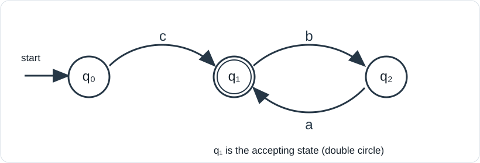

```{=html}
<style>
.definition-box,
.formula-box,
.theorem-box {
  border-radius: 0.45rem;
  padding: 1rem 1.15rem 0.85rem;
  margin: 1.15rem 0;
}
.definition-box {
  border: 1px solid #3f718e;
  border-left: 0.55rem solid #3f718e;
  background: rgba(63, 113, 142, 0.08);
}
.formula-box {
  border: 1px solid #aab4bf;
  border-left: 0.45rem solid #748596;
  background: rgba(127, 127, 127, 0.06);
}
.theorem-box {
  border: 2px solid #b02a37;
  border-left: 0.55rem solid #b02a37;
  background: rgba(176, 42, 55, 0.07);
}
.definition-box > :first-child,
.formula-box > :first-child,
.theorem-box > :first-child { margin-top: 0; }
.definition-box > :last-child,
.formula-box > :last-child,
.theorem-box > :last-child { margin-bottom: 0; }
.definition-title,
.formula-title,
.theorem-title {
  font-weight: 700;
  margin-bottom: 0.45rem;
}
.definition-title { color: #285d78; }
.formula-title { color: #526475; }
.theorem-title { color: #b02a37; }
@media (prefers-color-scheme: dark) {
  .definition-box {
    border-color: #79b6d4;
    background: rgba(121, 182, 212, 0.10);
  }
  .definition-title { color: #9bd1eb; }
  .formula-box {
    border-color: #8999aa;
    background: rgba(170, 185, 200, 0.08);
  }
  .formula-title { color: #c2ced9; }
  .theorem-box {
    border-color: #ff6b7a;
    background: rgba(255, 107, 122, 0.10);
  }
  .theorem-title { color: #ff8a96; }
}
</style>
```

# Finite words and languages

The lecture studies automata that operate on finite words. **Finite-state automata** and **regular expressions** are introduced as two ways of representing the same objects. The first step is to establish the vocabulary of symbols, words, concatenation, alphabets, and languages.

## Symbols, words, and the empty word

A **symbol** is an elementary character used to build words. Symbols are commonly denoted by letters such as $a$, $b$, and $c$.

A **word** is a finite sequence of symbols. For example,

$$
w=abcaa
$$

is a word containing five symbols. The **length** of a word $w$, denoted by $|w|$, is the number of symbols in the sequence. Therefore,

$$
|abcaa|=5.
$$

::: {.definition-box}
<div class="definition-title">Definition - Empty word</div>

The **empty word** is the unique word containing no symbols. It is denoted by the Greek letter epsilon, $\varepsilon$, and has length zero.

$$
|\varepsilon|=0.
$$

The empty word is a word even though it contains no symbols. It acts as the identity element for concatenation.
:::

## Concatenation of words

The basic operation on words is **concatenation**. Given two words $w$ and $v$, their concatenation is obtained by writing the symbols of $v$ immediately after the symbols of $w$. The operation is denoted by a dot, $\cdot$.

For the example in the lecture, let

$$
w=abbca, \qquad v=ccc.
$$

Their concatenation is

::: {.formula-box}
<div class="formula-title">Concatenation</div>

$$
w\cdot v=abbcaccc.
$$
:::

Concatenation is **not commutative** in general. The order of the words matters, so $w\cdot v$ and $v\cdot w$ need not be equal. The empty word is the identity element:

::: {.formula-box}
<div class="formula-title">Identity property of the empty word</div>

$$
\varepsilon\cdot w=w\cdot\varepsilon=w.
$$
:::

When the meaning is clear, the dot is omitted and concatenation is written simply as $wv$.

## Concatenation of sets of words

Let $A$ and $B$ be two sets of words. Their concatenation contains every word obtained by concatenating one word from $A$ with one word from $B$.

::: {.definition-box}
<div class="definition-title">Definition - Concatenation of languages or word sets</div>

$$
A\cdot B
=\{u\cdot w\mid u\in A\text{ and }w\in B\}.
$$
:::

This definition extends concatenation from individual words to sets of words. Every possible pair of choices, with the first word taken from $A$ and the second from $B$, contributes a word to the resulting set.

The identities recorded in the lecture are

::: {.formula-box}
<div class="formula-title">Set concatenation identities</div>

$$
A\cdot\{\varepsilon\}=A,
\qquad
\{\varepsilon\}\cdot A=A,
\qquad
A\cdot\varnothing=\varnothing.
$$
:::

The first two identities follow from the identity property of $\varepsilon$. The last identity holds because the empty set contains no word that could be selected for concatenation.

## Powers of a set and Kleene closure

For every integer $m\geq 0$, the power $A^m$ denotes the concatenation of $m$ copies of $A$.

::: {.definition-box}
<div class="definition-title">Definition - Powers of a set of words</div>

For $m>0$,

$$
A^m=\underbrace{A\cdot A\cdots A}_{m\text{ times}}.
$$

The zero-th power and the recursive step are defined by

$$
A^0=\{\varepsilon\},
\qquad
A^{m+1}=A^m\cdot A.
$$
:::

The **Kleene closure** of a set of words $A$, denoted by $A^*$, is the union of all its finite powers. The zero-th power is included, so the empty word belongs to the closure.

::: {.definition-box}
<div class="definition-title">Definition - Kleene closure</div>

$$
A^*=\bigcup_{m\geq 0}A^m
=\{\varepsilon\}\cup A\cup A^2\cup A^3\cup\cdots.
$$
:::

For example, when $A=\{a\}$,

$$
A^*=\{\varepsilon,a,aa,aaa,\ldots\}.
$$

The **positive closure** contains the positive powers and excludes the empty word.

::: {.formula-box}
<div class="formula-title">Positive closure</div>

$$
A^+=A^*\setminus\{\varepsilon\}
=\bigcup_{m>0}A^m.
$$
:::

The difference between $A^*$ and $A^+$ is whether zero repetitions are allowed. Kleene closure includes zero repetitions, while positive closure requires at least one repetition.

# Alphabets and languages

## Alphabets and words over an alphabet

An **alphabet** is a finite set of symbols. The lecture uses the alphabet

::: {.definition-box}
<div class="definition-title">Definition - Alphabet</div>

$$
A=\{a,b,c\}.
$$

A word over $A$ is any finite sequence whose symbols all belong to $A$. Equivalently, every word over $A$ is an element of $A^*$.
:::

For example, the word $w=abbca$ has length five and is therefore an element of $A^5$. Since every word of length five is also a finite word over $A$,

$$
w=abbca\in A^5\subseteq A^*.
$$

Here, $A^5$ is the set of all words of length five over $A$, while $A^*$ contains words of every finite length, including zero.

## Languages

A **language over the alphabet $A$** is any subset of $A^*$.

::: {.definition-box}
<div class="definition-title">Definition - Language over an alphabet</div>

$$
L\subseteq A^*.
$$
:::

A language is therefore a set of finite words over a fixed alphabet. The automata introduced next provide a finite-state mechanism for deciding which words belong to a language.

# Deterministic finite-state automata

A **deterministic finite-state automaton**, abbreviated DFA, reads a word one symbol at a time. At every step, the current state and the next input symbol determine exactly one next state.

## Formal definition of a DFA

The lecture denotes a deterministic finite automaton by the calligraphic letter $\mathcal{A}$. Its formal definition is a five-component tuple.

::: {.definition-box}
<div class="definition-title">Definition - Deterministic finite automaton</div>

A DFA $\mathcal{A}$ is a tuple

$$
\mathcal{A}=(Q,A,\delta,q_0,F),
$$

where

- $Q$ is a finite set of states, often written $Q=\{q_0,q_1,\ldots,q_n\}$;
- $A$ is a finite input alphabet;
- $\delta$ is the transition function, with type
  $$
  \delta:Q\times A\longrightarrow Q;
  $$
- $q_0\in Q$ is the initial state;
- $F\subseteq Q$ is the set of final states.
:::

The transition function $\delta$ takes a state and one input symbol and returns exactly one state. This is the defining feature of determinism: there is one prescribed next state for each state-symbol pair.

In the graphical representation of a finite-state automaton:

- states are drawn as nodes;
- transitions are directed edges labelled with input symbols;
- the initial state is marked by an incoming arrow that does not originate at another state;
- final states are drawn with a double circle.

The following image preserves the handwritten transition-graph example introduced with the DFA definition.

{fig-cap="A transition-graph example introduced with the formal definition of a DFA." fig-alt="Handwritten finite-state transition graph with an initial arrow, labelled edges, and a loop."}

## Extending the transition function to words

The transition function $\delta$ is defined for one input symbol. To describe the effect of reading a complete word, the lecture introduces an extended transition function denoted by **delta with a hat**, $\widehat{\delta}$.

::: {.definition-box}
<div class="definition-title">Definition - Extended transition function for a DFA</div>

The extended transition function has type

$$
\widehat{\delta}:Q\times A^*\longrightarrow Q.
$$

It is defined recursively by the following two clauses:

$$
\widehat{\delta}(q,\varepsilon)=q,
$$

$$
\widehat{\delta}(q,wa)
=\delta\bigl(\widehat{\delta}(q,w),a\bigr),
\qquad w\in A^*,\ a\in A.
$$
:::

The first clause says that reading the empty word leaves the automaton in its starting state. The second clause describes a non-empty word as a prefix $w$ followed by its last symbol $a$. The automaton first reads $w$, then applies the ordinary transition function to the state reached and the final symbol $a$.

For a word consisting of one symbol, the extended and ordinary transition functions agree:

::: {.formula-box}
<div class="formula-title">One-symbol case</div>

$$
\widehat{\delta}(q,a)=\delta(q,a).
$$
:::

The hat is retained whenever the transition function is applied to a word. This keeps the distinction between the one-symbol function $\delta$ and the word function $\widehat{\delta}$ explicit.

## Acceptance of words and the language of a DFA

A word is accepted when the automaton reaches a final state after consuming the entire word.

::: {.definition-box}
<div class="definition-title">Definition - Acceptance by a DFA</div>

A word $w\in A^*$ is accepted by a DFA $\mathcal{A}$ if and only if

$$
\widehat{\delta}(q_0,w)\in F.
$$
:::

The computation always starts at $q_0$. The condition is checked after every symbol of the word has been read, not at an intermediate step.

The language accepted by $\mathcal{A}$ is denoted by $L(\mathcal{A})$.

::: {.definition-box}
<div class="definition-title">Definition - Language accepted by a DFA</div>

$$
L(\mathcal{A})
=\{w\in A^*\mid \widehat{\delta}(q_0,w)\in F\}.
$$
:::

### Example: processing the word `cbaba`

The lecture considers the word

$$
w=cbaba.
$$

The corresponding DFA has initial state $q_0$, accepting state $q_1$, and a third state $q_2$. Its transitions for this example are shown below.

{fig-cap="The DFA used in the lecture to trace the input word cbaba. State q1 is accepting." fig-alt="A three-state DFA. The initial state q0 moves to accepting state q1 on c, q1 moves to q2 on b, and q2 returns to q1 on a."}

Reading the input from left to right gives the following sequence of states.

| Input read so far | State reached |
|:--|:--:|
| $\varepsilon$ | $q_0$ |
| $c$ | $q_1$ |
| $cb$ | $q_2$ |
| $cba$ | $q_1$ |
| $cbab$ | $q_2$ |
| $cbaba$ | $q_1$ |

The last state is $q_1$, which is accepting. Therefore the complete word is accepted:

::: {.formula-box}
<div class="formula-title">Result of the computation</div>

$$
\widehat{\delta}(q_0,cbaba)=q_1\in F.
$$
:::

The trace also illustrates why visiting a final state during the computation is not sufficient. Acceptance depends on the state reached after the whole input word has been consumed.

## Completing an incomplete automaton

The definition of a DFA requires a transition for every pair in $Q\times A$. A drawn automaton may omit some transitions, so its diagram may be an incomplete representation of the required transition function.

The lecture's method for completing such an automaton is to add a **sink state**:

1. Add a new state that is not final.
2. Direct every previously missing transition to this state.
3. Add a self-loop at the sink state for every symbol in the alphabet.

Once the automaton enters the sink state, it remains there and cannot reach a final state. The language is unchanged: an input that previously encountered a missing transition is rejected, and after completion its computation ends in the non-final sink state.

## The membership problem and regular languages

Given a DFA $\mathcal{A}$ and a word $w$, the **membership problem** asks whether the word belongs to the language accepted by the automaton.

::: {.formula-box}
<div class="formula-title">Membership question</div>

$$
w\in L(\mathcal{A})\ ?
$$
:::

A language over $A$ is called **regular** when it is accepted by some DFA.

::: {.definition-box}
<div class="definition-title">Definition - Regular language</div>

A language $L\subseteq A^*$ is regular if and only if there exists a DFA $\mathcal{A}$ such that

$$
L=L(\mathcal{A}).
$$
:::

# Non-deterministic finite-state automata

A **non-deterministic finite-state automaton**, abbreviated NFA, has the same five components as a DFA. The difference is its transition function: a state-symbol pair may lead to a set of possible next states rather than a single state.

## Formal definition of an NFA

::: {.definition-box}
<div class="definition-title">Definition - Non-deterministic finite automaton</div>

An NFA $\mathcal{A}$ is a tuple

$$
\mathcal{A}=(Q,A,\delta,q_0,F),
$$

where

- $Q$ is a finite set of states;
- $A$ is a finite input alphabet;
- $\delta$ is a transition function with type
  $$
  \delta:Q\times A\longrightarrow 2^Q;
  $$
- $q_0\in Q$ is the initial state;
- $F\subseteq Q$ is the set of final states.
:::

The notation $2^Q$ denotes the **power set** of $Q$, which is the set of all subsets of $Q$. Thus, $\delta(q,a)$ is a set of possible destination states.

The same transitions can also be represented by a relation

::: {.formula-box}
<div class="formula-title">Relational representation of NFA transitions</div>

$$
\Delta\subseteq Q\times A\times Q.
$$
:::

A triple $(q,a,q')\in\Delta$ means that the automaton may move from state $q$ to state $q'$ while reading the symbol $a$. The relation can contain several triples with the same first two components, representing several possible destinations for the same state-symbol pair.

## Multiple possible transitions on one symbol

The diagram in the lecture illustrates the difference between a DFA and an NFA. From state $q$, reading the symbol $a$ may leave the automaton in $q$ through a loop, or move it to $q'$, or move it to $q''$.

{fig-cap="On input a, an NFA may have several possible next states from the same current state." fig-alt="An NFA with a self-loop on q and two outgoing transitions labelled a, leading to q-prime and q-double-prime."}

The transition function collects all possible destinations in a single set. The automaton therefore tracks a set of possible current states after reading an input prefix.

## Extending the transition function to words

For an NFA, the extended transition function returns a set of states. The lecture again denotes the extension by a hat over delta.

::: {.definition-box}
<div class="definition-title">Definition - Extended transition function for an NFA</div>

The extended transition function has type

$$
\widehat{\delta}:Q\times A^*\longrightarrow 2^Q.
$$

Its initial condition is

$$
\widehat{\delta}(q,\varepsilon)=\{q\}.
$$

For a word $wa$, its recursive definition is

$$
\widehat{\delta}(q,wa)
=\bigcup_{r\in\widehat{\delta}(q,w)}\delta(r,a),
\qquad w\in A^*,\ a\in A.
$$
:::

The empty word leaves the NFA in its original state, so the result is the singleton set containing that state. For a word $wa$, the automaton considers every state reachable after reading $w$. It then takes the transitions on the final symbol $a$ from all of those states and unions the resulting sets.

The lecture also extends the function to a set of starting states. This is useful when the automaton is already in several possible states.

::: {.definition-box}
<div class="definition-title">Extension to a set of starting states</div>

For a set $P\subseteq Q$, the extended transition function is

$$
\widehat{\delta}:2^Q\times A^*\longrightarrow 2^Q,
$$

with

$$
\widehat{\delta}(P,w)
=\bigcup_{q\in P}\widehat{\delta}(q,w).
$$
:::

The result is the union of all states reachable after reading $w$ from each state in the starting set $P$.

## Acceptance of words by an NFA

An NFA accepts a word when at least one possible computation ends in a final state.

::: {.definition-box}
<div class="definition-title">Definition - Acceptance by an NFA</div>

A word $w\in A^*$ is accepted by an NFA $\mathcal{A}$ if and only if

$$
\widehat{\delta}(q_0,w)\cap F\neq\varnothing.
$$
:::

The intersection condition expresses the existential nature of NFA acceptance. It is enough that the set of reachable states contains at least one final state. Other possible computations may end in non-final states.

As for a DFA, the language accepted by an NFA is the set of all words that it accepts. The acceptance condition is the only part of the definition that needs to be interpreted differently.

::: {.formula-box}
<div class="formula-title">Language accepted by an NFA</div>

$$
L(\mathcal{A})
=\{w\in A^*\mid \widehat{\delta}(q_0,w)\cap F\neq\varnothing\}.
$$
:::

The two acceptance tests can be compared directly.

| Automaton | Acceptance condition |
|:--|:--|
| DFA | $\widehat{\delta}(q_0,w)\in F$ |
| NFA | $\widehat{\delta}(q_0,w)\cap F\neq\varnothing$ |

# Equivalence of DFA and NFA

The lecture concludes with the equivalence theorem for deterministic and non-deterministic finite-state automata.

::: {.theorem-box}
<div class="theorem-title">Equivalence of DFA and NFA</div>

For every NFA $\mathcal{A}$, there exists a DFA $\mathcal{A}'$ such that

$$
L(\mathcal{A})=L(\mathcal{A}').
$$

The converse also holds: for every DFA, there exists an NFA accepting the same language.
:::

The theorem states that allowing several possible next states does not increase the class of languages recognized by finite-state automata. A non-deterministic automaton may provide a different representation of a language, but a deterministic automaton exists that accepts exactly the same language. Conversely, a DFA is a special case of an NFA in which every transition set contains exactly one state.

The lecture states the equivalence result here. It does not develop the construction of the equivalent DFA, so that construction is not added to this chapter.
