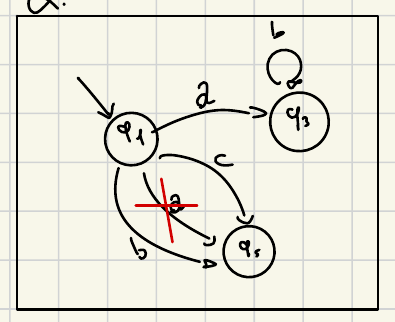
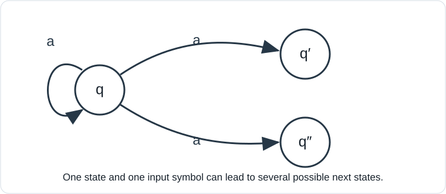

```{=html}
<style>
.theorem-box {
  border: 2px solid #b02a37;
  border-left: 0.55rem solid #b02a37;
  border-radius: 0.45rem;
  padding: 1rem 1.15rem 0.85rem;
  margin: 1.25rem 0;
  background: rgba(176, 42, 55, 0.07);
}
.theorem-box > :first-child { margin-top: 0; }
.theorem-box > :last-child { margin-bottom: 0; }
.theorem-title {
  color: #b02a37;
  font-weight: 700;
  margin-bottom: 0.45rem;
}
@media (prefers-color-scheme: dark) {
  .theorem-box {
    background: rgba(255, 107, 122, 0.10);
    border-color: #ff6b7a;
  }
  .theorem-title { color: #ff8a96; }
}
</style>
```

# Preliminaries: finite words and languages

The lecture begins with automata over finite words. Finite-state automata and regular expressions are introduced as two ways of representing the same kind of objects. Before defining automata, it establishes the basic vocabulary for symbols, words, concatenation, alphabets and languages.

## Symbols, words and the empty word

A **symbol** is an elementary character from which words are formed. Symbols are commonly denoted by letters such as \(a\), \(b\), and \(c\).

A **word** is a finite sequence of symbols. For example,

\[
w = abcaa
\]

is a word consisting of five symbols. The **length** of a word \(w\), written \(|w|\), is the number of symbols in that sequence. Thus, \(|abcaa|=5\).

The **empty word**, denoted by \(\varepsilon\), is the unique word containing no symbols. Its length is zero:

\[
|\varepsilon|=0.
\]

The empty word is still a word. It plays the role of an identity for concatenation.

## Concatenation of words

The basic operation on words is **concatenation**. Given two words \(w\) and \(v\), their concatenation, written \(w\cdot v\) (or simply \(wv\)), is the word obtained by writing the symbols of \(v\) immediately after the symbols of \(w\), without inserting a separator.

For example, let

\[
w=abba, \qquad v=ccc.
\]

Then

\[
w\cdot v=abbaccc.
\]

Concatenation is not commutative in general: the order of the two words matters. In this example,

\[
w\cdot v=abbaccc \neq cccabba=v\cdot w.
\]

The empty word is the identity element:

\[
\varepsilon\cdot w=w\cdot\varepsilon=w.
\]

The dot is often omitted when the meaning is clear. The lecture uses it explicitly when introducing concatenation and then relies on the shorter notation where convenient.

## Concatenation of sets of words

Let \(A\) and \(B\) be two sets of words. Their concatenation is the set containing every word obtained by concatenating one element of \(A\) with one element of \(B\):

\[
A\cdot B
=\{u\cdot w \mid u\in A \text{ and } w\in B\}.
\]

This definition lifts word concatenation to sets: every possible choice of a first word from \(A\) and a second word from \(B\) contributes a concatenated word to the result.

The empty word and the empty set give the following identities:

\[
A\cdot\{\varepsilon\}=A,
\qquad
\{\varepsilon\}\cdot A=A,
\qquad
A\cdot\varnothing=\varnothing.
\]

The first two identities follow because concatenating any word with \(\varepsilon\) leaves it unchanged. The last identity follows because there is no element to choose from the empty set.

## Powers of a set and Kleene closure

For every integer \(m\geq 0\), the power \(A^m\) denotes the concatenation of \(m\) copies of \(A\):

\[
A^m=\underbrace{A\cdot A\cdots A}_{m\text{ times}}.
\]

The zero-th power is defined separately as

\[
A^0=\{\varepsilon\},
\]

and the powers can be defined recursively by

\[
A^{m+1}=A^m\cdot A.
\]

The **Kleene closure** of a set of words \(A\), denoted by \(A^*\), is the union of all its finite powers, including the zero-th power:

\[
A^*=\bigcup_{m\geq 0} A^m
=\{\varepsilon\}\cup A\cup A^2\cup A^3\cup\cdots.
\]

Consequently, \(A^*\) contains the empty word as well as every word that can be formed by concatenating finitely many elements of \(A\).

For the example \(A=\{a\}\), the closure is

\[
A^*=\{\varepsilon,a,aa,aaa,\ldots\}.
\]

The **positive closure** excludes the empty word:

\[
A^+=A^*\setminus\{\varepsilon\}
=\bigcup_{m>0}A^m.
\]

The distinction is therefore whether zero repetitions are allowed: \(A^*\) includes zero repetitions, while \(A^+\) contains only positive numbers of repetitions.

# Alphabets and languages

## Alphabets and words over an alphabet

An **alphabet** is a finite set of symbols. For example, consider

\[
A=\{a,b,c\}.
\]

A word over the alphabet \(A\) is any finite sequence whose symbols all belong to \(A\). Equivalently, it is an element of \(A^*\).

For example, the word

\[
w=abbca
\]

has length five and satisfies

\[
w\in A^5\subseteq A^*.
\]

Here, \(A^5\) is the set of all words of length five over the alphabet \(A\), whereas \(A^*\) contains words of every finite length, including zero.

## Languages

A **language over the alphabet** \(A\) is any subset of \(A^*\):

\[
L\subseteq A^*.
\]

Thus, a language is a set of words over a fixed alphabet. It may contain words of different lengths. The automata introduced next provide a finite-state mechanism for deciding which words belong to a language.

# Deterministic finite-state automata

A **deterministic finite automaton** (DFA) is a finite-state machine that reads a word one symbol at a time. At each step, the current state and the next input symbol uniquely determine the next state.

## Formal definition of a DFA

A DFA \(\mathcal A\) is a tuple

\[
\mathcal A=(Q,A,\delta,q_0,F),
\]

where:

- \(Q\) is a finite set of states, often written \(Q=\{q_0,q_1,\ldots,q_n\}\);
- \(A\) is a finite input alphabet;
- \(\delta\) is the transition function,
  \[
  \delta:Q\times A\to Q;
  \]
- \(q_0\in Q\) is the initial state;
- \(F\subseteq Q\) is the set of final, or accepting, states.

The transition function takes a state-symbol pair and returns exactly one state. This is the formal meaning of *deterministic*: there is one prescribed next state for every current state and input symbol.

In the graphical notation for automata, states are drawn as nodes, transitions as directed labelled edges, and the initial state is identified by an incoming arrow from nowhere. Accepting states are represented by double circles. The following is the transition-graph example introduced with the definition.

{fig-cap="A transition-graph example introduced with the DFA definition." fig-alt="Handwritten DFA transition graph with an initial arrow, labelled transitions, and a loop"}

## Extending the transition function to words

The function \(\delta\) is initially defined for one input symbol. To describe the effect of reading a complete word, it is extended to

\[
\widehat{\delta}:Q\times A^*\to Q.
\]

The extension is defined recursively. Reading the empty word leaves the automaton in the state where it started:

\[
\widehat{\delta}(q,\varepsilon)=q.
\]

If a word is written as \(wa\), where \(w\in A^*\) and \(a\in A\), first read \(w\), then process the final symbol \(a\):

\[
\widehat{\delta}(q,wa)
=\delta\bigl(\widehat{\delta}(q,w),a\bigr).
\]

The recursive definition follows the order in which the symbols are read. It first determines the state reached after the prefix \(w\), and then applies the ordinary one-symbol transition for \(a\).

For a single symbol, the extended and original functions agree:

\[
\widehat{\delta}(q,a)=\delta(q,a).
\]

For simplicity, the notation \(\delta(q,w)\) is also often used for the extended function, with the hat omitted when the meaning is clear.

## Acceptance of words and the language of a DFA

A word \(w\in A^*\) is **accepted** by a DFA \(\mathcal A\) if and only if the state reached after reading the entire word is final:

\[
\widehat{\delta}(q_0,w)\in F.
\]

The initial state matters because the computation always begins at \(q_0\). The final-state condition is checked only after all symbols of the word have been consumed.

The language accepted by \(\mathcal A\), denoted by \(L(\mathcal A)\), consists of all and only the words over its alphabet that it accepts:

\[
L(\mathcal A)
=\{w\in A^*\mid \widehat{\delta}(q_0,w)\in F\}.
\]

### Example: processing the word `cbaba`

The following automaton reproduces the example in the lecture. Its initial state is \(q_0\), its accepting state is \(q_1\), and its third state is \(q_2\).

{fig-cap="The DFA example used to process the word cbaba." fig-alt="DFA used to process the word cbaba"}

For the input word \(w=cbaba\), the computation proceeds as follows:

| Input read so far | Current state |
|:--|:--:|
| \(\varepsilon\) | \(q_0\) |
| \(c\) | \(q_1\) |
| \(cb\) | \(q_2\) |
| \(cba\) | \(q_1\) |
| \(cbab\) | \(q_2\) |
| \(cbaba\) | \(q_1\) |

The word is accepted because the computation finishes in \(q_1\), which is an accepting state. In the notation of the extended transition function,

\[
\widehat{\delta}(q_0,cbaba)=q_1\in F.
\]

This illustrates that acceptance depends on the state reached after the *whole* word, not on whether an accepting state was visited at some intermediate point.

## Completing an incomplete automaton

The formal definition of a DFA uses a transition function

\[
\delta:Q\times A\to Q.
\]

This function is defined for every pair consisting of a state and an alphabet symbol. A diagram may nevertheless omit some transitions. Such a drawing is an **incomplete representation** of the transition function.

The lecture's completion method is to add a **sink state**. Every transition that was missing is directed to this new state, and the sink state loops to itself on every input symbol. The sink is not accepting. Therefore, once a computation enters it, it cannot later reach an accepting state.

This completion does not change the language recognized by the automaton: a word that previously encountered a missing transition is rejected, and after completion it reaches the non-accepting sink instead.

## The membership problem and regular languages

Given an automaton \(\mathcal A\) and a word \(w\), the **membership problem** asks whether

\[
w\in L(\mathcal A)?
\]

For a language \(L\subseteq A^*\), the lecture uses the following definition:

\[
L\text{ is regular}\quad\Longleftrightarrow\quad
\text{there exists a DFA }\mathcal A\text{ such that }L=L(\mathcal A).
\]

In other words, a language is regular when some deterministic finite-state automaton accepts exactly its words.

# Non-deterministic finite-state automata

A **non-deterministic finite automaton** (NFA) has the same overall components as a DFA, but its transition function may return a set of possible next states rather than one state. This is the only component of the tuple that changes in the definition given in the lecture.

## Formal definition of an NFA

An NFA \(\mathcal A\) is a tuple

\[
\mathcal A=(Q,A,\delta,q_0,F),
\]

with:

- \(Q\) a finite set of states;
- \(A\) a finite alphabet;
- \(\delta\) a transition function of type
  \[
  \delta:Q\times A\to 2^Q;
  \]
- \(q_0\in Q\) the initial state;
- \(F\subseteq Q\) the set of final states.

The notation \(2^Q\) denotes the **power set** of \(Q\), namely the set of all subsets of \(Q\). Consequently, for a state \(q\) and symbol \(a\), the value \(\delta(q,a)\) is a set of possible destination states.

Equivalently, the transitions can be represented as a relation

\[
\Delta\subseteq Q\times A\times Q.
\]

A triple \((q,a,q')\in\Delta\) means that the automaton may move from \(q\) to \(q'\) while reading symbol \(a\). Unlike a function into a single state, this relation can associate the same state-symbol pair with several destinations.

## Reading the same symbol along multiple possible transitions

The following schematic diagram shows the non-deterministic choice represented in the lecture: from state \(q\), reading \(a\) may leave the machine in \(q\), or move it to \(q'\), or move it to \(q''\).

{fig-cap="A single state-symbol pair may have several possible destinations in an NFA." fig-alt="An NFA with three possible destinations from q on input a"}

Thus, after reading one symbol, an NFA may have several possible current states. The transition function records all of them together as a subset of \(Q\).

## Extending the NFA transition function to words

For an NFA, the extended transition function returns a set of states:

\[
\widehat{\delta}:Q\times A^*\to 2^Q.
\]

The base case is

\[
\widehat{\delta}(q,\varepsilon)=\{q\}.
\]

For a word \(wa\), the automaton considers every state reachable after reading \(w\), takes its possible transitions on \(a\), and unions all the resulting sets:

\[
\widehat{\delta}(q,wa)
=\bigcup_{r\in\widehat{\delta}(q,w)}\delta(r,a).
\]

The union is essential. It collects every state that can be reached by extending any possible computation on the prefix \(w\) with the final symbol \(a\).

The lecture also gives the corresponding extension to a set of starting states. For \(P\subseteq Q\) and \(w\in A^*\),

\[
\delta:2^Q\times A^*\to 2^Q,
\qquad
\delta(P,w)=\bigcup_{q\in P}\widehat{\delta}(q,w).
\]

This expression combines the states reachable after reading \(w\) from each possible starting state in \(P\).

## Acceptance of words by an NFA

A word \(w\in A^*\) is accepted by an NFA \(\mathcal A\) if and only if at least one state reachable after reading the complete word is final:

\[
\widehat{\delta}(q_0,w)\cap F\neq\varnothing.
\]

The intersection condition expresses the existential nature of NFA acceptance. It is sufficient that one possible computation ends in a final state; other possible computations may end in non-final states.

As for a DFA, the language \(L(\mathcal A)\) consists of all and only the words over \(A\) accepted by the automaton. The definition of the language is therefore the same in purpose, although the acceptance test differs:

| Automaton | Acceptance condition for \(w\) |
|:--|:--|
| DFA | \(\widehat{\delta}(q_0,w)\in F\) |
| NFA | \(\widehat{\delta}(q_0,w)\cap F\neq\varnothing\) |

# Equivalence of DFA and NFA

The lecture concludes with the equivalence theorem for deterministic and non-deterministic finite automata.

::: {.theorem-box}
<div class="theorem-title">DFA–NFA language equivalence</div>

For every NFA \(\mathcal A\), there exists a DFA \(\mathcal A'\) such that

\[
L(\mathcal A)=L(\mathcal A').
\]

Conversely, every DFA can also be regarded as an NFA. Therefore, DFA and NFA recognize exactly the same class of languages.
:::

The theorem says that allowing several possible next states does not increase the class of languages that finite-state automata can recognize. An NFA may offer a different representation of a language, but a DFA exists that recognizes the same language. The reverse direction follows because a deterministic transition can be represented as a set containing exactly one destination state.
